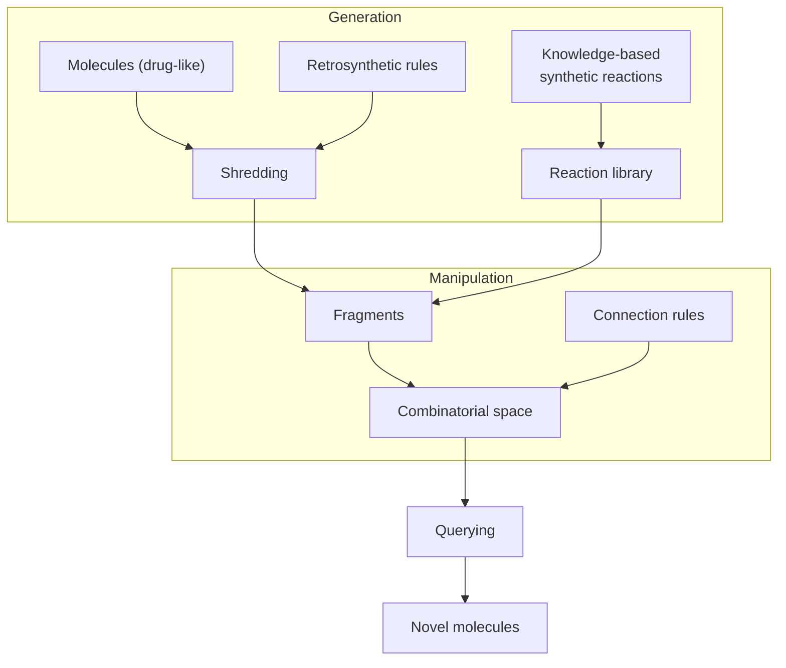

# Fragment spaces

A **fragment space** is the set of molecules that can be formed from a given set of
fragments under prescribed linkage rules — a combinatorially huge molecule set defined
*implicitly*, never enumerated.

## Why it matters

[[concepts/chemical-space]] contains > 10⁶⁰ molecules, but for most of them **the synthesis
route is unknown — no synthetic accessibility**. A fragment space fixes this by
construction: since every member is assembled from real fragments using rules derived from
real chemistry, everything in the space is (in principle) makeable.

The second gain is representational. A space of 10¹² molecules can be stored as a few
thousand fragments plus a rule table — small enough to hold in memory, and searchable
without enumeration (see [[concepts/fragment-space-search]]).

## Two ways to build one

```text
SHREDDING
    identification of synthetically easily formable bonds
    cleavage of molecules from a database
    → fragments come from molecules that exist

CONSTRUCTIVE
    transfer of synthesis protocols from combinatorial chemistry
    → fragments and rules come from reactions that work
```


*Generate fragments (by shredding or from reaction knowledge), combine them into an implicit space, then query it.*

## RECAP — synthetically meaningful fragmentation

```text
GOAL: analysis of molecule sets to identify 'interesting' fragments

MOLECULE SET: a heterogeneous collection of active compounds
              for a target protein

CUT RULES:
    only ACYCLIC bonds
    only SYNTHETICALLY MEANINGFUL bonds
    store the LINKAGE POINTS
```

Cutting only acyclic bonds keeps ring systems intact — the same principle as the
[[concepts/linkers-and-chains]] decomposition, and for the same reason: rings are rigid
structural units that should not be broken. Storing the linkage points is what makes
re-assembly possible at all.

## Link atoms and link types

```text
fragments contain so-called LINK ATOMS
the LINK TYPE indicates from which rule the fragment arose

rules define not only the CUT but also the RE-ASSEMBLY:
    compatibility of links
    modification via topology / geometry
    terminal groups for open links
```

This is the crucial detail. A cut rule is bidirectional: the same rule that broke an amide
bond says that an acid-type link may only be joined to an amine-type link. Compatibility
typing is what prevents the space from containing nonsense.

## BRICS

```text
BRICS FRAGMENT SPACE — goals:
    modelling of BIOISOSTERES
    geometrically consistent link types
    precise characterisation of the chemical ENVIRONMENT of the link
```

BRICS refines RECAP by making link types environment-aware: it is not enough to know that a
bond was an amide, one must know what sat on either side of it.

## Caveats

- "Synthetically accessible in principle" is not the same as "a chemist can make it this
  week"; retrosynthetic rules ignore protecting groups, selectivity and yield.
- The space inherits the bias of the molecules that were shredded.
- Combinatorial size means the space can never be validated exhaustively — only sampled.

## See also

- [[concepts/chemical-space]]
- [[concepts/fragment-space-search]]
- [[concepts/de-novo-design]]
- [[concepts/combinatorial-libraries]]
- [[concepts/linkers-and-chains]]
- [[concepts/fragment-based-drug-design]]

## Sources

- [[sources/ciw-06-flexible-docking-binding-sites-and-fragment-spaces]] (pp. 21–22)
