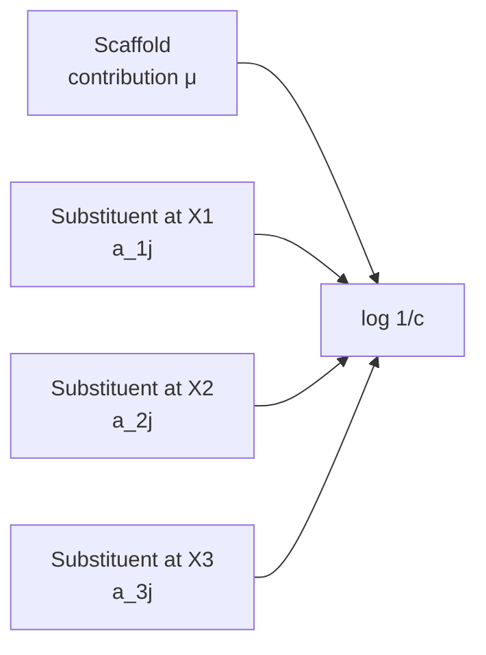
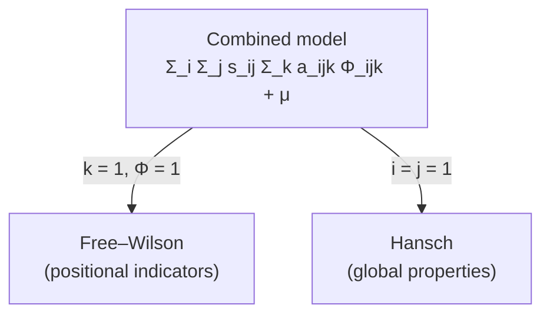

# Free–Wilson analysis and the combined approach

A QSAR model that correlates **substituents directly** with biological activity, using
indicator variables instead of physico-chemical descriptors — and the combined model that
contains both Free–Wilson and [[concepts/hansch-analysis]] as special cases.

## Why it matters

Free–Wilson needs no descriptors at all. It asks only "which substituent sits at which
position?", which makes it applicable when no meaningful parameters are available, and
makes its coefficients trivially interpretable: aᵢⱼ *is* the contribution of that
substituent at that site.

## The Free–Wilson model

```text
IDEA: substituents are directly correlated with the biological activity.
  - the base scaffold provides a contribution μ to the biological activity
  - at a series of substitution sites X_1, X_2, ... there are different
    substituents  s_11..s_1n, s_21..s_2m, ...
  - regression determines the contribution a_ij of substituent s_ij

MODEL:
        log 1/c  =   Σ        Σ         a_ij · δ_ij   +   μ
                  substitution  substituents
                     sites i        j

        δ_ij = 1  if substituent s_ij sits at X_i
        δ_ij = 0  otherwise
```

The design matrix is therefore a **block of 0/1 indicator columns**, one block per
substitution site:

```text
            |  X1: s11 s12 ... |  X2: s21 s22 ... |  X3: ...
  molecule1 |      1   0       |      0   1       |            × [a-vector] = [log 1/c]
  molecule2 |      0   1       |      1   0       |
  molecule3 |      1   0       |      1   0       |
```


*Activity is modelled as a pure sum of independent positional contributions — no interaction terms.*

## Trade-offs

| Advantages (+) | Disadvantages (−) |
|---|---|
| simple to carry out — **no physico-chemical descriptors needed** | many substitution sites are required |
| takes the **constitution** into account (i.e. *where* the change is) | large number of free variables → **little predictive power** |
| gives quantitatively good models | prediction only for **new combinations of known substituents** |

The third disadvantage is fundamental: a substituent that never appears in the training set
has no fitted coefficient, so the model simply cannot speak about it. Hansch, using
continuous parameters, can.

## The combined approach

Compute physico-chemical properties k for the substituents sᵢⱼ, written Φ_ijk, with free
parameters a_ijk:

```text
MODEL:
        log 1/c  =   Σ        Σ        s_ij ·   Σ        a_ijk · Φ_ijk   +  μ
                  sites i  substituents j     properties k

SPECIAL CASES:
        Free–Wilson :  k = 1 ,  Φ_ijk = 1       // indicator variables only
        Hansch      :  i = j = 1                // one site, one substituent slot
```


*Two historically separate methods turn out to be two corners of one parameterisation.*

This unification is the exam-relevant point: Free–Wilson knows *where*, Hansch knows
*what*, and the combined model knows both.

## Caveats

- The number of free variables grows as (sites × substituents × properties) — directly
  motivating [[concepts/principal-component-analysis]] and
  [[concepts/partial-least-squares]].
- Purely additive: no term captures interaction between two substitution sites.

## See also

- [[concepts/hansch-analysis]]
- [[concepts/qsar]]
- [[concepts/physicochemical-parameters]]
- [[concepts/qsar-model-validation]]
- [[concepts/matched-molecular-pairs]]

## Sources

- [[sources/ciw-05-pharmacophores-qsar-and-docking]] (pp. 17–18)
