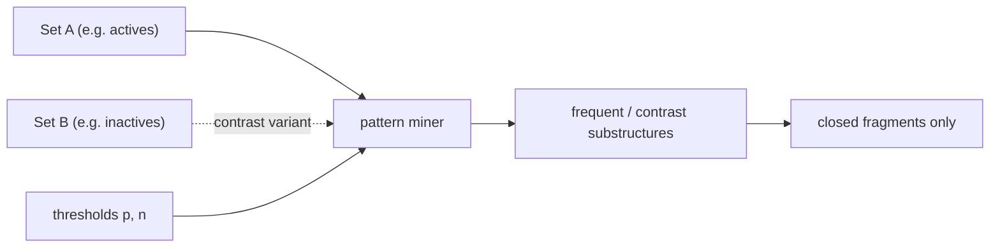

# Frequent Pattern Mining

Given a set of molecules `A` and a threshold `p`, find **all substructures that occur in at
least p % of the molecules in A**.

## Why it matters

A substructure that is common to the actives of an assay and rare among the inactives is a
candidate **pharmacophore fragment**. Frequent pattern mining is therefore the unsupervised
counterpart to [[concepts/virtual-screening]]: instead of asking "does this molecule contain
my query?" ([[concepts/subgraph-isomorphism]]), it asks "which query would be interesting?"

## Definitions

| Term | Definition |
|---|---|
| **Support** `sup_A(S)` | the percentage of molecules of `A` that contain substructure `S` |
| **Closed fragment** | `S` is *closed* if there is no substructure `S' ⊋ S` with `sup_A(S') = sup_A(S)` |
| **Frequent pattern** | `S` with `sup_A(S) ≥ p` |
| **Contrast pattern** | given two molecule sets `A`, `B` and thresholds `p`, `n`: all `S` with `sup_A(S) ≥ p` **and** `sup_B(S) ≤ n` |

A closed fragment is the **maximal** representative of its support class — reporting only
closed fragments removes a large amount of redundant output.


*Frequent pattern mining takes one molecule set (or two, for contrast mining) and returns substructures meeting the support constraints.*

## Algorithmic idea

```text
ALGORITHM FrequentPatternMining(A, p)
  INPUT : molecule set A, support threshold p
  OUTPUT: all substructures S with sup_A(S) ≥ p

  1. enumerate all substructures, storing all embeddings (mappings)
  2. extend the substructures successively (one bond per level)
  3. abort a branch as soon as the support for a substructure is too small
```

**Boundary condition:** only *connected* substructures are considered, and the search starts
from a **start fragment**.

## Data structures

| Structure | Representation |
|---|---|
| **Substructure** | as the set of node numbers of a molecule that contains the substructure |
| **Embedding** | a vector mapping each node of the substructure to a node in the molecule (may occur multiple times per molecule) |

Keeping all embeddings is what makes the extension step cheap: a child node of the search
tree is generated by extending every stored embedding, rather than by re-running a
subgraph-isomorphism search.

## Caveats

- Enumerating substructures is exponential in the worst case; the whole method lives or
  dies by its pruning ([[concepts/moss-algorithm]]).
- Support is defined over **molecules**, not over embeddings — a substructure occurring five
  times in one molecule still contributes support 1.
- Negative support `sup_B` is **not** monotone along the search tree and therefore cannot be
  used for pruning; it only filters the output.

## See also

- [[concepts/moss-algorithm]]
- [[concepts/subgraph-isomorphism]]
- [[concepts/vf2-algorithm]]
- [[exercises/ciw-e4-moss-and-surfaces]]

## Sources

- [[sources/ciw-03-pattern-mining-diagrams-surfaces-and-reduced-graphs]] (p. 1)
