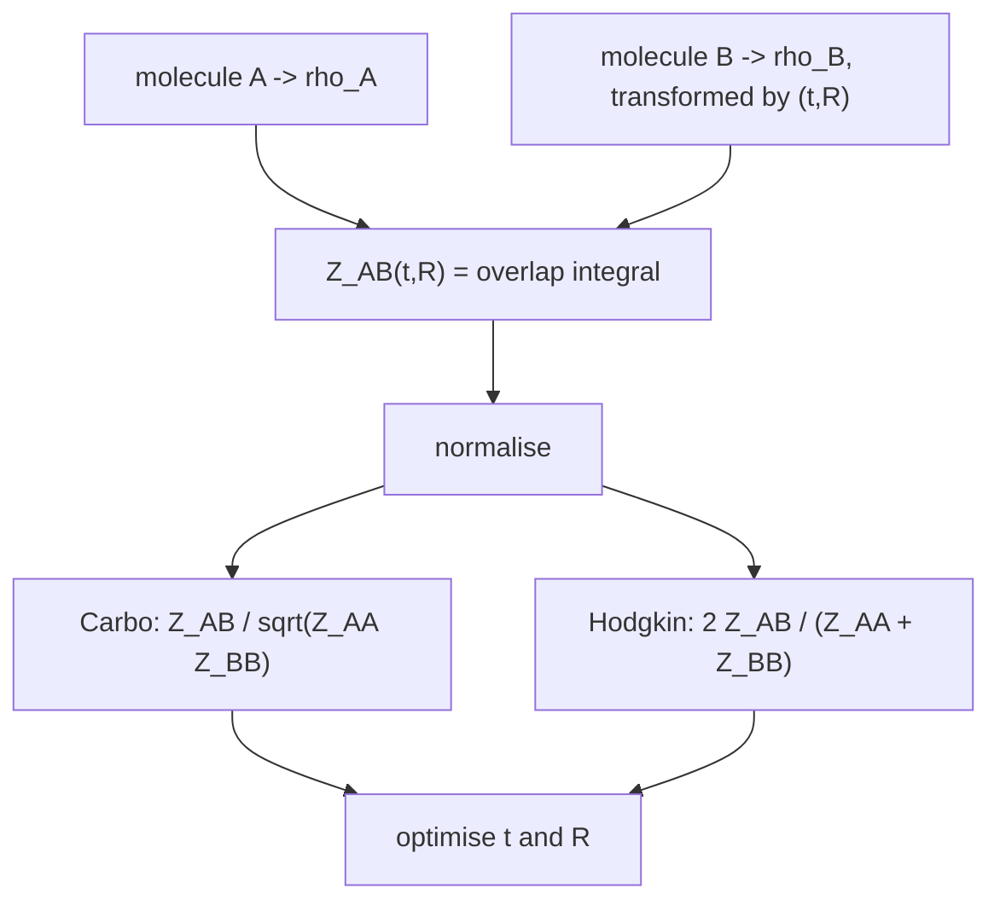

# Gaussian Molecular Representation and Similarity Indices

A general and easily handled concept for modelling various molecular properties: place a
**Gaussian bell at every atom** and turn "how well do two molecules overlap?" into an
integral.

## Why it matters

Hard spheres ([[concepts/lennard-jones-potential]]) give a volume that is discontinuous in
the atom positions — bad for optimisation. Gaussians are smooth and infinitely
differentiable, so the overlap becomes a differentiable objective function that a local
optimiser can follow. This is what makes [[concepts/seal-algorithm]] possible.

## The model

```text
Gaussian function     f(x) = a · e^{−b(x − x₀)²}
      a  : property factor        (e.g. atomic volume)
      b  : width of the bell
      x₀ : origin (the atom centre)

molecule described by ρ(x) = Σ_{atoms i} a_i · e^{−b|x − x_i|²}
      ρ(x) is the "density" at point x
```

## Overlap integral

```text
Z_AB           = ∫ ρ_A(x) · ρ_B(x) dx            # how well the molecules lie on top of each other

with translation t and rotation R:
Z_AB(t, R)     = ∫ ρ_A(x) · ρ_B(R x − t) dx      # the objective function -> maximise
```

## Normalised similarity indices

| Index | Formula |
|---|---|
| **Carbó** | `C_AB(t,R) = Z_AB(t,R) / sqrt(Z_AA · Z_BB)` |
| **Hodgkin** | `H_AB(t,R) = 2·Z_AB(t,R) / (Z_AA + Z_BB)` |

Carbó measures the **correlation** of the properties — intensities play only a minor role.
Hodgkin normalises by the arithmetic rather than the geometric mean and therefore penalises
size differences more strongly.


*The unnormalised overlap grows with molecular size, so it must be normalised before it can be optimised as a similarity.*

## Closed form

Substituting the Gaussians:

```text
Z_AB(t,R) = ∫ Σ_{atoms i,j} a_i e^{−b|x − x_i|²} · a_j e^{−b|x − y_j|²} dx ,   y_j = R x_j − t
```

and after integration:

```text
                    ____
Z_AB(t,R) =  √(π / 2b) · Σ_{atoms i,j} a_i a_j · e^{−(b/2)|x_i − y_j|²}
```

⇒ the integral disappears: the overlap is a **double sum over atom pairs**, evaluable in
`O(|A|·|B|)`. This closed form is the objective function of
[[concepts/seal-algorithm]] (`S_AB(t,R)`).

## Modelling several properties at once

```text
w_ij = Σ_{properties p} k_p · a_ip · a_jp          k_p = weight of the property
```

Advantages: the exponential function is evaluated **only once** per atom pair, and `b`
cannot vary per property. **No matching between functional groups is necessary** — the
method is **purely numerical**.

That last point is the essential trade-off: no combinatorial matching problem has to be
solved, but equally the result carries no explicit correspondence between groups.

## See also

- [[concepts/seal-algorithm]]
- [[concepts/molecular-superposition]]
- [[concepts/lennard-jones-potential]]
- [[concepts/flexible-superposition]]

## Sources

- [[sources/ciw-04-descriptor-evaluation-clustering-and-superposition]] (p. 14)
