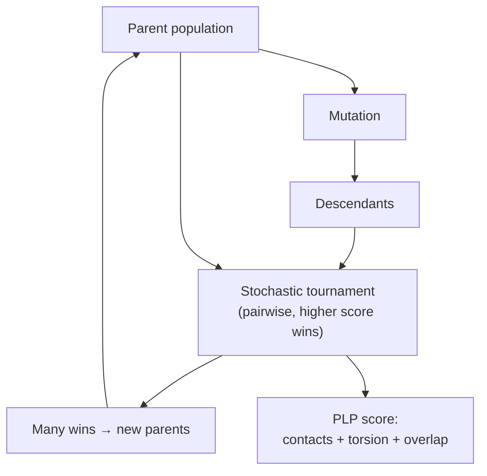

# Genetic algorithm docking

Randomised [[concepts/flexible-docking|flexible docking]] in which a chromosome encodes a
pose (and conformation) and an evolutionary loop optimises the population against a scoring
function.

## Why it matters

GAs sidestep the combinatorial explosion by never enumerating: they sample, recombine, and
let selection do the search. The same machinery already appeared in GASP for
[[concepts/flexible-superposition]] — the only thing that changes here is what the
chromosome encodes and what the fitness function measures.

## GOLD

```text
GOLD  (similar to GASP / superposition)
  chromosome: assignment of interaction groups + ligand conformation
  fitness evaluation:
      the ligand is superimposed onto the protein's interaction groups
      according to the assignment
  score: H-bond term + van der Waals term
```

## DOCK + GA

```text
Two chromosome encodings:

(a) SPHERE-BASED
      chromosome stores a matching of ligand atoms to spheres
      in the active site          → cf. the DOCK sphere model

(b) EXPLICIT ORIENTATION
      chromosome stores an explicit translation vector
      plus three Euler angles

scoring: force field = van der Waals term + electrostatics
```

Encoding (a) inherits the sphere representation of [[concepts/dock-algorithm]]; encoding
(b) throws that away and parameterises the rigid-body transformation directly. (a) restricts
the search to chemically plausible placements; (b) can express any pose but wastes effort on
absurd ones.

## Evolutionary programming

```text
EVOLUTIONARY PROGRAMMING (EP)
  generate an initial set of 'parents'
  generate 'descendants' by MUTATION              (no crossover)
  STOCHASTIC TOURNAMENT:
      select two opponents
      the opponent with the higher score wins
      candidates with many wins become parents

  SCORING = PLP function (piecewise linear potential)
      intermolecular: atom-pair contacts,
                      empirically derived parameters for
                      piecewise linear functions
      intramolecular: torsion angle potential + overlap term
```


*Evolutionary programming keeps only mutation and replaces deterministic selection by a noisy tournament.*

The intramolecular term is what makes EP genuinely flexible: a torsion potential plus a
self-overlap penalty means the chromosome cannot buy a good fit by folding the ligand into
an impossible conformation.

## Caveats

- No convergence guarantee and run-to-run variability; several independent runs are
  standard practice.
- Fitness is the scoring function, so all the limits of
  [[concepts/scoring-functions]] apply directly to the search, not just to the ranking.
- GOLD's chromosome presupposes an interaction-group assignment, i.e. it already assumes the
  binding site is known and annotated.

## See also

- [[concepts/flexible-docking]]
- [[concepts/randomised-docking]]
- [[concepts/dock-algorithm]]
- [[concepts/scoring-functions]]
- [[concepts/flexible-superposition]]

## Sources

- [[sources/ciw-06-flexible-docking-binding-sites-and-fragment-spaces]] (p. 4)
