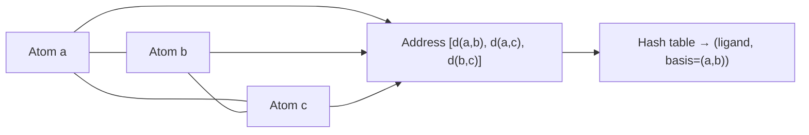
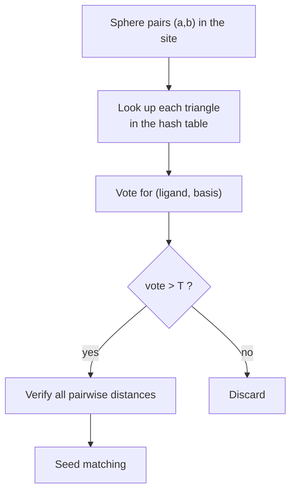

# Geometric hashing for docking (Fischer)

A rigid docking method that searches a **ligand database directly**, by borrowing geometric
hashing from pattern recognition and indexing all ligand atom triplets in a hash table.

## Why it matters

The other docking algorithms dock one ligand at a time. Fischer's method inverts the
direction: the database is preprocessed into an index, and the *protein* is the query. That
makes it the docking analogue of [[concepts/pharmer-algorithm]].

It reuses the **sphere representation of [[concepts/dock-algorithm]]** for the site.

## Building the hash table

```text
ALGORITHM BuildHashTable
FOR each ligand atom triplet (a,b,c):
    address := [ d(a,b), d(a,c), d(b,c) ]
    entry   := (ligand, basis)
    // the BASIS is the atom pair (a,b)
    insert entry at address
```


*A triangle of distances is rotation- and translation-invariant, so it can be looked up before any pose is known.*

## Search: seed matching by voting

```text
SEARCH ALGORITHM — two stages
    1. SEED-MATCHING : search for a matching of bases with many matches
                       of third atoms c
    2. EXTENSION     : check and extend the matchings from stage 1
```

```text
ALGORITHM SeedMatching (voting scheme)
FOR each sphere pair (a,b):                     // candidate basis in the SITE
    FOR each sphere c:
        FOR each (ligand, basis) IN hashtable[ d(a,b), d(a,c), d(b,c) ]:
            increase the VOTE for (ligand, basis)
            add (3rd ligand atom, c) to the matching list (basis, ligand)

FOR each (ligand, basis) with vote > T:
    check ALL pairwise distances
    include in the seed-matching list
```


*Many independent triangle lookups agreeing on the same (ligand, basis) is strong evidence — voting replaces explicit combinatorial search.*

## Extending a matching

```text
ALGORITHM ExtendMatching
    RMSD-fit of the ligand atoms onto the spheres according to the matching
    adaptation of the matching
    overlap test
    evaluation
```

## Difference to classical pattern recognition

```text
PATTERN RECOGNITION:
    a d-dimensional basis defines a UNIQUE reference coordinate system

HERE:
    the complexity is reduced to a 2-dimensional basis (an atom PAIR)
    ⇒ matches must possibly NOT be superimposable
```

This is the key compromise. In 3D a basis of two points does *not* fix a coordinate frame —
one rotational degree of freedom is left, the same one [[concepts/clix-algorithm]] scans.
Using a 2-point basis keeps the hash table small (O(n³) triplets keyed on pairs rather than
O(n⁴)), at the cost that a voted match need not correspond to a consistent rigid
transformation — hence the explicit verification of all pairwise distances before a seed is
accepted.

## Caveats

- The vote threshold T trades sensitivity against the size of the verification workload.
- Hash table size grows cubically in atoms per ligand, times the database size.
- Rigid ligands only.

## See also

- [[concepts/docking]]
- [[concepts/dock-algorithm]]
- [[concepts/pharmer-algorithm]]
- [[concepts/clix-algorithm]]
- [[concepts/rmsd-and-point-set-superposition]]
- [[concepts/atom-pair-and-triplet-descriptors]]

## Sources

- [[sources/ciw-05-pharmacophores-qsar-and-docking]] (p. 29)
