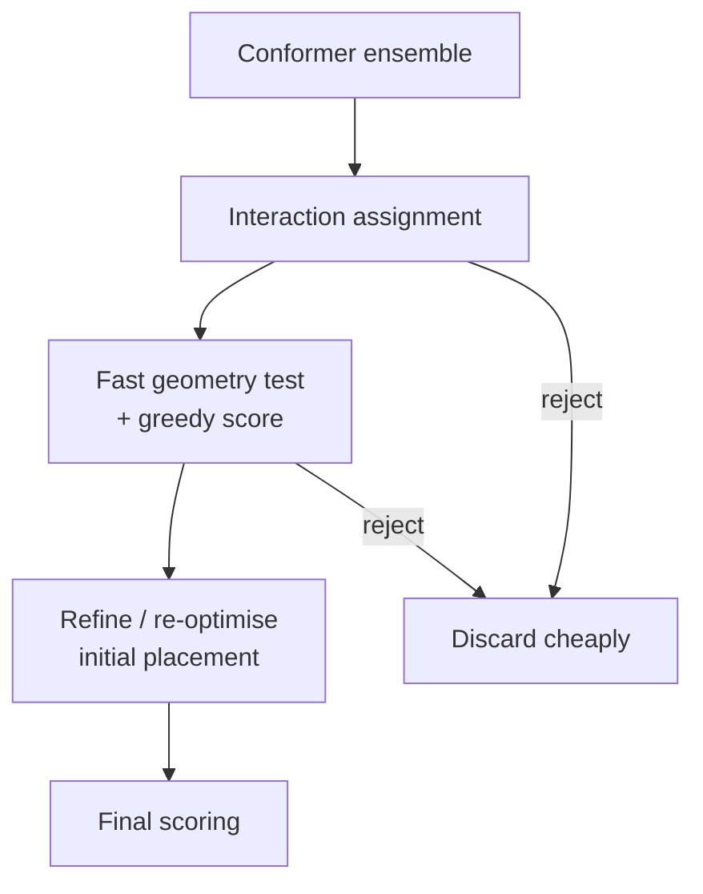

# GLIDE hierarchical filtering

A docking strategy built entirely out of **successive filters**, each cheaper than the one
after it, so that expensive scoring is only ever applied to a small surviving set.

## Why it matters

Marked in the notes as **"today top"** — the currently leading approach. The idea is not a
new geometric insight but a scheduling one: order the work so that most candidates die
cheaply.

## Mechanics

```text
ALGORITHM Glide
1. computation of an ENSEMBLE of conformations
2. search for a suitable assignment of interactions
3. fast, first geometry test + GREEDY SCORE
4. refinement / re-optimisation of the initial placement
5. final scoring
```


*A funnel: each stage is more expensive and sees fewer candidates than the one before it.*

The economics are the point:

| Stage | Cost per candidate | Candidates seen |
|---|---|---|
| geometry test + greedy score | very low | all |
| re-optimisation | medium | few |
| final scoring | high | very few |

This is the same funnel logic that governs
[[concepts/virtual-screening]] as a whole, and the same filter-then-verify structure as
[[concepts/caveat-algorithm]].

## Caveats

- A cheap early filter that rejects a true binder can never be recovered later — the funnel
  is only as good as its first stage.
- The greedy score is a different function from the final score, so the ranking can change
  discontinuously between stages.

## See also

- [[concepts/docking]]
- [[concepts/flexible-docking]]
- [[concepts/virtual-screening]]
- [[concepts/scoring-functions]]

## Sources

- [[sources/ciw-06-flexible-docking-binding-sites-and-fragment-spaces]] (p. 3)
