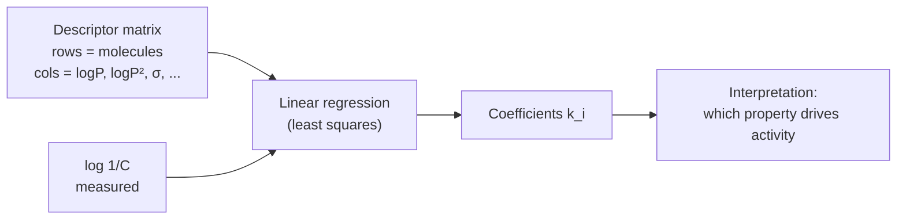

# Hansch analysis

A QSAR model that regresses the activity of a compound series against **global
physico-chemical parameters**, with a quadratic logP term.

## Why it matters

Hansch analysis is the original QSAR. Its lasting contribution is the quadratic term: it
encodes the fact that activity is *not* monotone in lipophilicity — too little and the
compound never reaches the target, too much and it never leaves the membrane.

## The model

```text
log 1/C  =  k1 · (logP)^2  +  k2 · logP  +  k3 · σ  +  ...  +  k

log 1/C : equi-effective molar doses
          (the concentration of the compound needed to achieve
           the same biological effect)
logP, σ, ... : parameters describing the molecules
k_i          : free parameters of the model

METHOD:   linear regression
          [ properties matrix ] × [ k vector ] = [ biological data log 1/C ]
EVALUATION: size of the squared deviations
```

The `(logP)²` term is explicitly annotated in the notes as **removal of linearity**
(Aufhebung der Linearität) — the model stays linear *in the parameters kᵢ*, so ordinary
least squares still applies, while being non-linear in the underlying property.

```text
    log 1/C
      ^
      |        ___
      |      /     \            parabola in logP:
      |    /         \          an optimum lipophilicity exists
      |  /             \
      +------------------> logP
```


*The matrix equation is the whole method; everything interesting is in the choice of columns.*

## Caveats

- Uses **global** molecular parameters, so it cannot say *where* on the molecule a change
  should be made — that is exactly what [[concepts/free-wilson-analysis]] adds.
- Needs a congeneric series: the parameters are only comparable within one scaffold.
- Collinearity between logP and (logP)² and between σ and MR inflates coefficient variance.

## See also

- [[concepts/qsar]]
- [[concepts/free-wilson-analysis]]
- [[concepts/lipophilicity-and-logp]]
- [[concepts/physicochemical-parameters]]
- [[concepts/qsar-model-validation]]

## Sources

- [[sources/ciw-05-pharmacophores-qsar-and-docking]] (p. 16)
