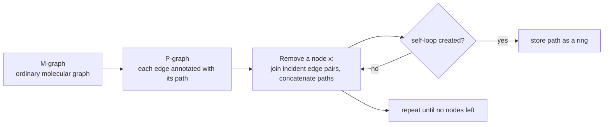

# Hanser All-Rings Algorithm (Collapsing P-Graph)

Enumerates **Ω, the set of all rings** of a molecule, by repeatedly deleting nodes from a
*path graph* and recording the loops that appear.

## Idea

- Annotate **paths on the edges** — this gives a **P-graph**.
- Remove nodes successively, create new edges and concatenate the paths → a **multigraph** arises.
- **Loops represent cycles** and can be stored.


*Node elimination turns paths into longer paths; a path that closes on itself is a ring.*

## Data on an edge

| Field | Meaning |
|---|---|
| `v.inc` | incidence list of node v (set of incident edges) |
| `e.to(v)` | the node incident to e other than v |
| `e.path` | the path annotated on edge e |
| `e.mid` | the path without its endpoints |

## Algorithm

```text
ALGORITHM REMOVE-NODE(x, G, R)
  INPUT : node x to eliminate, P-graph G, ring set R
  OUTPUT: G reduced by x, R extended

  for each pair e, k ∈ x.inc with k ≠ e:
      if e.mid ∩ k.mid == ∅:                     # paths share only x
          n      <- new edge (e.to(x), k.to(x))
          n.path <- e.path ∪ k.path
          G.E    <- G.E ∪ {n}
  for each e ∈ x.inc:
      if e.path.is-cycle(): R <- R ∪ {e.path}    # a ring was found
      G.E <- G.E \ {e}
  G.V <- G.V \ {x}

ALGORITHM ALL-RINGS(G)
  R <- ∅
  while G.V ≠ ∅:
      x <- node from G.V with |x.inc| minimal    # heuristic
      REMOVE-NODE(x, G, R)
  return R
```

**Condition check:** for each edge pair, test whether `x` is the *only* common node. If yes,
create a new edge. If `x` is not the only common node, the generated path would not be simple.

### Worked example

```text
[a-c] / \ [a-b]        remove b        a          remove c        (a)
  c ---- b        ───────────▶   c ─[a-b-c]─    ───────────▶   loop [a-b-c-a]
     [c-b]
```

## Heuristic choice of the next node x

- The **correctness** of the algorithm is **independent** of the removal order.
- **Efficiency gain** if the node with the **fewest incident edges** is deleted each time.

## Limitation

The number of rings in Ω can grow **exponentially** with molecule size, so Ω violates the
"polynomial" requirement of [[concepts/ring-perception]]. This motivates cycle bases.

## See also

- [[concepts/ring-perception]]
- [[concepts/cycle-space-and-cycle-basis]]
- [[concepts/relevant-cycles-and-vismara]]

## Sources

- [[sources/ciw-02-substructure-search-and-ring-perception]] (pp. 10–11)
