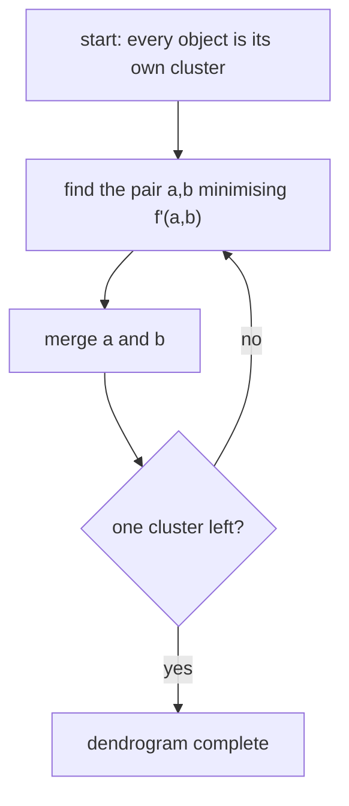

# Hierarchical Agglomerative Clustering

Build a **dendrogram** bottom-up by repeatedly merging the two closest clusters. Everything
interesting is in the choice of the cluster-distance function `f'`.

## Algorithm

```text
ALGORITHM HierarchicalAgglomerative(M, f, f')
  INPUT : set of objects M
          distance measure          f  : M × M → ℝ⁺
          distance over subsets     f' : 2^M × 2^M → ℝ⁺
  OUTPUT: dendrogram over M

  C = { {x} | x ∈ M }                 # singletons
  while |C| > 1:
      select a, b ∈ C minimising f'(a, b)
      C = ( C \ {a, b} ) ∪ { a ∪ b }
```

> **`f'` is the difference between the clustering algorithms.**


*The loop is trivial; the identity of the algorithm lies entirely in f'.*

## The four classical linkages

| Linkage | `f'(A,B)` | Geometric meaning |
|---|---|---|
| **a) Single linkage / nearest neighbour** | `min_{a∈A, b∈B} f(a,b)` | closest pair of members |
| **b) Complete linkage / furthest neighbour** | `max_{a∈A, b∈B} f(a,b)` | most distant pair of members |
| **c) Group average** | `(1/(\|A\|·\|B\|)) Σ_{a∈A, b∈B} f(a,b)` | mean over all cross pairs |
| **d) Centroid cluster analysis** | `f(c(A), c(B))` with `c(A) = (1/\|A\|) Σ_{a∈A} a` | distance between the centroids |

⚠️ For **centroid** clustering the objects must be **geometrically interpretable** — a
centroid has to exist. The other three need only the distance matrix.

## Ward's method

The **information loss** caused by the clustering is described by an error function
(*Error Sum of Squares*):

```text
ESS(C)   = Σ_{a ∈ M} ( a − c(C_a) )²        # C_a = the cluster containing a

f'(A,B)  = ESS( (C \ {A,B}) ∪ {A∪B} )       # merge the pair that costs least information
```

Ward merges the pair whose union increases the total within-cluster variance the least,
which tends to produce compact, similarly sized clusters.

## Lance–Williams recursion

A **general recursion formula for `f'`** that subsumes the linkages:

```text
f'(C, A∪B) = α_A · f'(C,A) + α_B · f'(C,B) + β · f'(A,B)
                           + γ · | f'(C,A) − f'(C,B) |
```

| Parameters | Result |
|---|---|
| `α_A = α_B = ½`, `β = 0`, `γ = −½` | nearest neighbour |
| `α_A = α_B = ½`, `β = 0`, `γ = +½` | furthest neighbour |

⇒ the transition **NN → FN** is a single sign change in `γ`. The practical value is that one
implementation covers every linkage, and the distance to a merged cluster is obtained in
O(1) from the distances to its parts — no re-scanning of the members.

## See also

- [[concepts/clustering-of-molecules]]
- [[concepts/jarvis-patrick-clustering]]
- [[concepts/k-means-clustering]]
- [[exercises/ciw-e5-feature-trees]]

## Sources

- [[sources/ciw-04-descriptor-evaluation-clustering-and-superposition]] (pp. 9–10)
