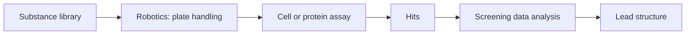

# High-Throughput Screening (HTS)

Systematically testing large compound libraries for active compounds.

## Definition

Screening of large substance libraries (Substanzbibliotheken) for active compounds.

## Prerequisites

- a **molecular test system** or **cell culture models**
- **substance libraries** (compound collections)


*HTS is an experimental strategy; cheminformatics contributes library design upstream and data analysis downstream.*

```text
ALGORITHM HighThroughputScreen(library L, assay A)
  INPUT : compound library, validated assay
  OUTPUT: hit list

  hits <- []
  for each compound c in L:
      signal <- A(c)                  # robotic measurement
      if signal > activityThreshold:
          hits.append(c)
  return deduplicate(filterArtefacts(hits))
```

## Relation to virtual screening

Virtual screening ([[concepts/virtual-screening]]) is the computational counterpart: it
pre-selects which compounds are worth putting into the assay, on the basis of similarity
and diversity.

## See also

- [[concepts/lead-finding-strategies]]
- [[concepts/virtual-screening]]

## Sources

- [[sources/ciw-01-drug-action-and-molecular-interactions]] (p. 18)
