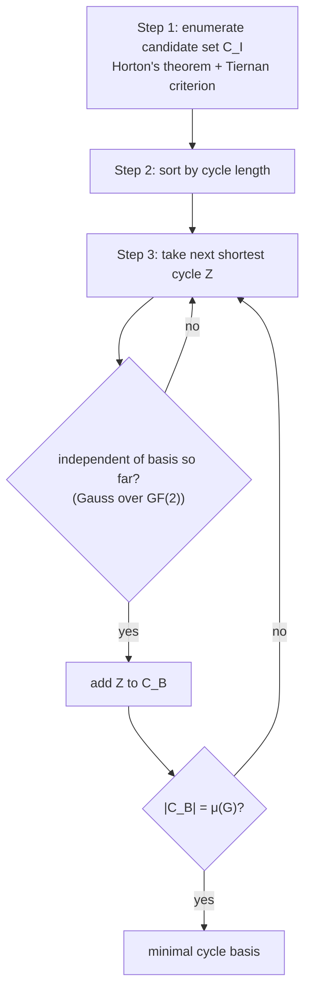

# Horton's Algorithm

Computes a **minimal cycle basis** ([[concepts/sssr-and-minimal-cycle-basis]]) by generating
a polynomial candidate set and greedily selecting independent cycles by increasing length.

## Idea

1. Enumerate all cycles that **can be part of** a minimal cycle basis (candidate set).
2. Consider the cycles in **ascending order of length**.
3. Check whether adding a cycle would create **linear dependence** (Gauss).
4. **Stop** as soon as **μ** cycles have been selected.


*A greedy matroid algorithm: shortest-first with an independence oracle.*

## Step 1: reducing the candidate set

### Horton's theorem (structural property of "relevant" cycles)

> Let `x` be a node in a cycle `C` of a minimal cycle basis. Then there exists an edge
> `e = (y,z) ∈ C` such that C consists of `e` and **two edge-disjoint shortest paths**, one
> path from `x` to `y` and one from `x` to `z`.

- Horton's criterion is **necessary but not sufficient**: there exist cycles satisfying
  Horton's property that are **not** part of any minimal cycle basis.
- **Significance**: it allows the enumeration of an initial set `C_I` from which a minimal
  cycle basis can be formed, with `|C_I| ≤ |V|·|E|`.

### Enumerating the initial set

- For each node `x ∈ V`, combine shortest paths `p(x,y)` and `p(x,z)` with an edge `e = (y,z) ∈ E`.
- Remove all combinations that are **not simple**.
- Reduce repeated enumeration of the same cycle with the **Tiernan method**: define an
  arbitrary order ≺ on the node set; keep shortest paths `p(x,y)` for which `x ≺ u` for all
  `u ∈ p(x,y)`.

```text
ALGORITHM CREATE-INITIAL-CYCLESET(G)
  INPUT : graph G = (V,E)
  OUTPUT: candidate cycle set C_I

  for each x ∈ V:
      P_BFS <- BFS-SHORTEST-PATHS(G, x)             # all shortest paths from x
      for each e = (y,z) ∈ E:
          for each p(x,y), p(x,z) ∈ P_BFS:
              if x ≠ min≺{ p(x,y) ∪ p(x,z) }: continue    # Tiernan criterion
              if p(x,y) ∩ p(x,z) ≠ {x}:        continue    # elementarity
              C_I <- C_I ∪ { p(x,y) ∪ (y,z) ∪ p(z,x) }
  return C_I
```

## Step 2: the greedy selection

```text
ALGORITHM Horton-Calc-Cyclebase(G)
  INPUT : graph G
  OUTPUT: minimal cycle basis C_B

  C_I <- CREATE-INITIAL-CYCLESET(G)
  SORT(C_I, cycle-length())
  C_B <- ∅
  while |C_B| < μ(G):
      Z   <- C_I.head();  C_I <- C_I.tail()
      if C_B.is-independent-cycle(Z):
          C_B <- C_B ∪ {Z}
  return C_B
```

## Complexity

| Part | Cost |
|---|---|
| Building `C_I` | O(\|V\|² \|E\|) |
| Sorting | O(\|V\| \|E\|) |
| while loop | \|V\|\|E\| iterations, independence test O(μ\|E\|) |
| **Total** | **O(μ · \|V\| · \|E\|²)** |

## See also

- [[concepts/sssr-and-minimal-cycle-basis]]
- [[concepts/cycle-space-and-cycle-basis]]
- [[concepts/relevant-cycles-and-vismara]]

## Sources

- [[sources/ciw-02-substructure-search-and-ring-perception]] (pp. 16–17)
