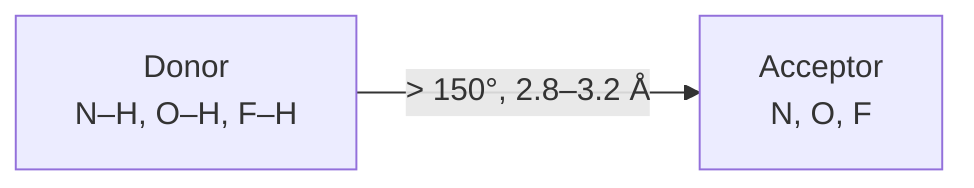

# Hydrogen Bond

A strongly **directional** electrostatic interaction in which a hydrogen atom bridges an
electronegative donor and an electronegative acceptor.

## Donor and acceptor

- **Hydrogen bond donor** — an electronegative atom carrying a proton: F–H, O–H, N–H.
- **Hydrogen bond acceptor** — an electronegative atom with a negative partial charge: F, O, N.

Common donor/acceptor pairs listed in the lecture:

```
O–H···O=C–      N–H···O=C
O–H···N=C–      N–H···N=C–
N–H···F–C       F–H···F–H
O–H···O–H–      O–H···F–H
```

## Geometry

| Parameter | Value |
|---|---|
| N–O distance | 2.8 – 3.2 Å |
| N–H···O angle | > 150° (often nearly linear) |
| C=O···H angle | 100 – 180° |

- Strongly **directional** interaction.
- H-bond length is often **shorter** than the sum of the van der Waals radii.


*A hydrogen bond is only a hydrogen bond if both distance and angle criteria are satisfied.*

## Scoring a hydrogen bond

Criteria for scoring a **single** hydrogen bond:

- **Distance** between acceptor and donor
- **Orientation** — correct orientation means the H points towards the acceptor and the
  donor atom points towards the hydrogen-bond donor
- **Geometry** — the hydrogen bond should be planar (ideal angle 180°)
- **Context** — evaluated in the context of the protein–ligand interaction; e.g. buried
  hydrogen bonds are more stable than those on the surface

Criteria for scoring a hydrogen-bond **network** between protein and ligand:

- **Network topology**, including the number of hydrogen bonds
- **Cooperativity** — degree of interaction between multiple hydrogen bonds
- **Dynamics** — flexibility and mobility of the residues
- **Accessibility** — location in the network; buried is more stable

### Scoring function used in the exercise

```text
ALGORITHM HBondScore(d, θ, a)
  INPUT : d = donor–acceptor distance, θ = deviation from ideal angle,
          a = minimal (ideal) distance
  OUTPUT: score in [0, 1]; 1 = best, 0 = worst

  score <- exp(−d + a) · cos(θ)
  return score
```
Ideal geometry (d = a, θ = 0) gives score = 1; the exponential penalises long bonds, the
cosine penalises non-linear geometry.

## Strength

Influenced by:
- the functional groups involved (**electronegativity** — higher difference ⇒ higher partial
  charge; O = 3.44, F = 4.0, H = 2.2 on the Pauling scale)
- **desolvation** of the functional groups
- restriction of the flexibility of the binding partners (favourable or unfavourable
  depending on the resulting order)

### Example: tyrosyl-tRNA synthetase / tyrosyl adenylate

- A mutation removing **one** hydrogen bond → loss of binding affinity.
- **NH → CH₂ exchange**: hydrogen bonds between protein and inhibitor are lost, but the
  balance is essentially **neutral** ⇒ Kᵢ barely changes (the trapped H₂O is freed,
  compensating the enthalpy loss).
- **NH → O exchange**: the hydrogen bond is likewise lost, but both acceptors can form a
  hydrogen bond in the **unbound** state ⇒ **Kᵢ worsens by three orders of magnitude**.

> This is the canonical illustration that H-bond *counting* predicts nothing;
> the balance sheet matters. See [[concepts/desolvation-and-water]].

## See also

- [[concepts/intermolecular-interactions]]
- [[concepts/desolvation-and-water]]
- [[concepts/lead-optimization-heuristics]]
- [[exercises/ciw-e1-thermodynamics-and-hydrogen-bonds]]

## Sources

- [[sources/ciw-01-drug-action-and-molecular-interactions]] (pp. 12, 15, 22)
