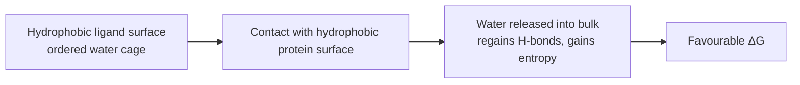

# Hydrophobic Effect

The tendency of lipophilic molecular surfaces to pack against each other, driven not by
attraction between them but by the **release of water**.

## Mechanism

- Association of hydrophobic surfaces of the molecules — **water regains its hydrogen bonds**.
- Based essentially on the **liberation of water**, not on a direct attractive force.
- Examples of hydrophobic groups: aromatics, methyl groups.


*The driving force is the water, not the contact itself.*

## Geometric properties

- Distance ≈ the sum of the van der Waals radii.
- Weakly directional (in contrast to hydrogen bonds).

## Quantitative contribution to binding affinity

- Correlates with the **size of the buried surface**.
- ≈ **−50 to −200 J·mol⁻¹·Å⁻²**

> ⚠️ **To verify:** the common textbook value is ≈ 25–30 cal·mol⁻¹·Å⁻²
> (≈ 105–125 J·mol⁻¹·Å⁻²), which sits inside but not at the centre of this range.
> Flagged in [[open-questions]].

```text
ALGORITHM HydrophobicContribution(complex)
  INPUT : protein P, ligand L, complex C
  OUTPUT: ΔG_hydrophobic [J/mol]

  SASA_free    <- SASA(P) + SASA(L)          # solvent accessible surface area
  SASA_bound   <- SASA(C)
  buried       <- SASA_free − SASA_bound     # in Ų
  return coefficient · buried                # coefficient ≈ −50 … −200 J/mol/Ų
```

## Caveat

Increasing the lipophilic contact surface is **not a cure-all**: solubility of the compound
decreases as the surface grows. See [[concepts/lead-optimization-heuristics]].

## Role in similarity descriptors

GCI part 4 names the hydrophobic effect as one of the interaction/property classes that a similarity descriptor may need to preserve. This links hydrophobic surface similarity to ligand-based screening when the protein geometry is not known.

## See also

- [[concepts/desolvation-and-water]]
- [[concepts/intermolecular-interactions]]
- [[concepts/enthalpy-entropy-compensation]]

## Sources

- [[sources/ciw-01-drug-action-and-molecular-interactions]] (p. 13)
- [[sources/gci-04-molecular-glues-descriptors-fingerprints-and-similarity]] (p. 2)
