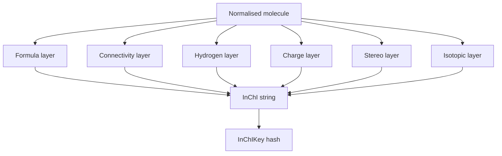

# InChI and InChIKey

InChI is a layered, normalised chemical identifier, and InChIKey is its fixed-length hashed search key.

## Why it matters

Chemical databases need a representation that supports molecule identification across drawings, names and files; InChI provides a standard text identifier, while InChIKey makes web and database lookup practical.

## How it works

InChI is written as a versioned string with layers. The GCI notes list the main layer and several optional layers: formula, connectivity, hydrogens, charge, stereochemistry, isotopic substitution, fixed hydrogens and fixed isotopic information.

```text
PROCEDURE BuildInCHI(molecule M)
  INPUT : normalised molecular graph with optional charge, stereo, isotope and fixed-H data
  OUTPUT: InChI string

  formula <- HillFormula(M)
  connectivity <- canonical heavy-atom connection table
  hydrogens <- mobile and fixed H information
  charge <- net charge and protonation information, if present
  stereo <- E/Z and tetrahedral stereochemistry, if present
  isotopes <- isotope labels, if present
  fixedH <- fixed locations of otherwise mobile hydrogens, if requested
  return concatenate version, normalisation type and non-empty layers
```

```text
PROCEDURE MakeInChIKey(inchi)
  INPUT : full InChI string
  OUTPUT: fixed-length key for searching

  normalise the InChI string
  hash the structural layers into key blocks
  encode the hash in a fixed-length alphabetic form
  return key
```


*InChI keeps chemically interpretable layers; InChIKey compresses them for lookup.*

## Practical notes

- Hill formula order is `C`, then `H`, then remaining elements alphabetically; if no carbon is present, all elements are alphabetical.
- The main layer stores the formula, heavy-atom connectivity and H-atom information.
- The connection layer describes bonds between heavy atoms; hydrogens are handled in a separate layer.
- The InChIKey is useful for search engines because it is short and fixed-length.

## Limitations / caveats

- InChIKey is hashed and therefore is not a complete replacement for the full InChI string.
- The source warns that additional opaque fields may occur in newer InChI versions; they should not be reverse-engineered as ordinary layers without documentation.

## See also

- [[concepts/molecular-file-formats]]
- [[concepts/molecular-canonicalization]]
- [[concepts/smiles]]

## Sources

- [[sources/gci-02-inchi-canonical-smiles-and-smarts]] (pp. 1-6, 17-18, 23-26)
