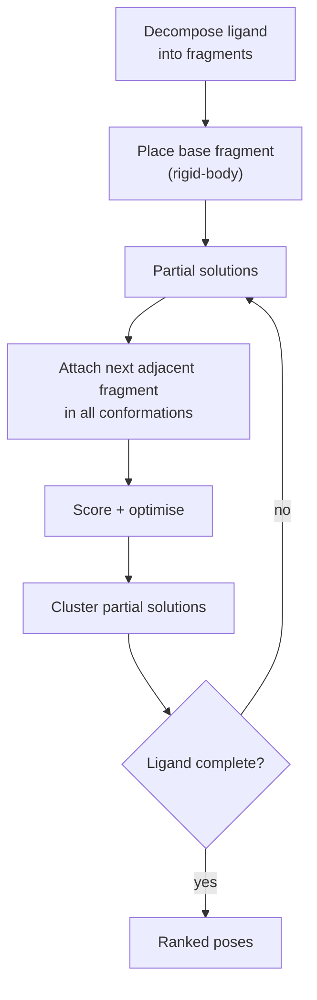

# Incremental construction docking

Decompose the ligand into fragments, place **one** fragment (the base) in the active site,
and grow the rest of the molecule onto it fragment by fragment, inside the pocket.

## Why it matters

This is the FlexX strategy and the most influential of the combinatorial
[[concepts/flexible-docking|flexible docking]] approaches. Unlike
[[concepts/place-and-join]], fragments are never placed independently: every fragment after
the base is positioned *relative to an already-docked partial ligand*, so the pocket prunes
the conformation space at every step instead of only at the end.

## Algorithm

```text
ALGORITHM IncrementalConstruction
INPUT : ligand L, active site S
OUTPUT: ranked docking solutions

  decompose the ligand into fragments
  select a few fragments as 'BASE'
  independent placement of the base fragments (rigid-body docking)

  incremental build-up of the ligand:
  WHILE the ligand is not completely built:
      FOR each partial docking solution:
          choose a fragment F adjacent to the already-built part
          FOR each conformation of F:
              attach F to the built part
              search for new interactions
              optimise the solution, scoring
      cluster the new partial docking solutions
      select the energetically favourable solutions for the next iteration
```


*The loop is a beam search over partial ligands; clustering keeps the beam from filling up with near-duplicates.*

## Search strategies

*Where to build on, and what?*

```text
BACKTRACKING
    recursive depth-first search through the
    COMPLETE configuration tree
    → cost ↑↑
    → LOW risk of a suboptimal solution

GREEDY
    select a CONSTANT set of partial solutions for the next step
    → O(n)
    → HIGHER risk of a suboptimal solution
```

| | Backtracking | Greedy |
|---|---|---|
| explores | whole configuration tree | fixed-width beam |
| cost | exponential | O(n) |
| risk of suboptimum | low | higher |

Practical systems use greedy with a beam width, which is exactly why the clustering step
matters: without it the beam fills with *n* variants of the same pose and the search
collapses to one branch.

## Open sub-problems

The notes list the three questions the skeleton leaves open:

- how to **score partial solutions** (a fragment of a ligand is not a ligand; the score is
  not comparable across build stages);
- **optimisation of the placement** at each step;
- **clustering of the placements** — which needs a distance measure, cf.
  [[concepts/pose-clustering]].

## Caveats

- A base fragment placed badly can never be repaired by the greedy variant.
- Scores of partial solutions are not on the same scale as scores of complete ligands, so
  the selection criterion in the loop is a heuristic, not the objective.
- Fragment decomposition itself affects the outcome; cf. the cut rules in
  [[concepts/fragment-spaces]].

## See also

- [[concepts/flexible-docking]]
- [[concepts/place-and-join]]
- [[concepts/pose-clustering]]
- [[concepts/flexible-superposition]]
- [[concepts/scoring-functions]]

## Sources

- [[sources/ciw-06-flexible-docking-binding-sites-and-fragment-spaces]] (p. 7)
