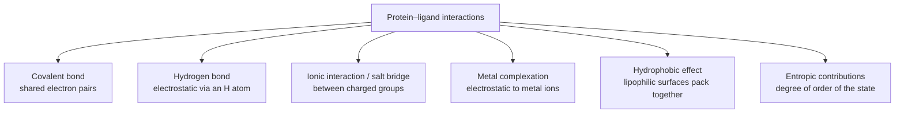

# Intermolecular Interactions

The catalogue of forces that hold a protein–ligand complex together.

## Types of protein–ligand interaction


*Six interaction classes distinguished in lecture 1.*

| Interaction | Description | Example |
|---|---|---|
| **Covalent bond** | shared electron pairs between protein and ligand atoms | irreversible inhibitors |
| **Hydrogen bond** | electrostatic interaction via an H atom | `C=O···H–N`, `O–H···O` |
| **Ionic (salt bridge)** | electrostatic interaction between charged groups | `COO⁻···H₃N⁺` |
| **Metal complexation** | electrostatic interaction with metal ions | `Zn²⁺···HS–` |
| **Hydrophobic effect** | packing of lipophilic molecular surfaces | `–CH₃···H₃C–` |
| **Entropic contributions** | degree of order of the state | released water molecules |

Detail pages: [[concepts/hydrogen-bond]], [[concepts/hydrophobic-effect]],
[[concepts/ionic-interactions-and-metal-complexation]].

## Relative strength

- Individual gas-phase association energies can **exceed** typical ligand binding affinities.
- In solution, every interaction competes with water → see [[concepts/desolvation-and-water]].
- Consequence: interaction counts do **not** add up to affinity
  ([[concepts/enthalpy-entropy-compensation]]).

```text
ALGORITHM NaiveInteractionScore(complex)      # why this is wrong
  score <- 0
  for each contact c in contacts(protein, ligand):
      score <- score + strength(type(c))      # additive assumption
  return score
  # FAILS: ignores desolvation cost and enthalpy–entropy compensation
```

## GCI interaction list

GCI part 4 repeats the interaction catalogue as the physical background for similarity: covalent bonds, metal complexation, water-mediated contacts, hydrophobic effects, ionic interactions and entropic contributions. This reinforces that a descriptor can preserve different binding-relevant aspects depending on which interaction class it encodes.

## See also

- [[concepts/protein-ligand-binding]]
- [[concepts/binding-thermodynamics]]
- [[concepts/molecular-structure-and-stereochemistry]]

## Sources

- [[sources/ciw-01-drug-action-and-molecular-interactions]] (pp. 11, 13)
- [[sources/gci-04-molecular-glues-descriptors-fingerprints-and-similarity]] (pp. 1-2)
