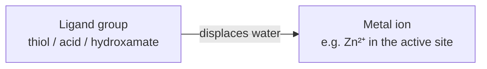

# Ionic Interactions and Metal Complexation

Electrostatic interactions between **charged** groups (salt bridges) and between a ligand
group and a **metal ion**.

## Ionic interactions (salt bridges)

- Association of **oppositely charged** groups.
- Distance: **2.7 – 3.0 Å**.
- Can be seen as two special cases:
  - **charge-supported hydrogen bonds** — geometry of the H-bond applies
  - **metal complexation** — geometry of the coordination applies

### When is a group charged?

```text
ALGORITHM ProtonationState(group, pH)
  INPUT : functional group with pKa, environment pH
  OUTPUT: charged or neutral

  if pH < pKa: group is protonated      # e.g. –NH2 -> –NH3⁺
  else:        group is deprotonated    # e.g. –COOH -> –COO⁻
```
*Protonation state ~ pKa value ~ pH value of the environment.*

## Geometric properties

- Charged hydrogen bonds: distance **shorter** than the sum of the van der Waals radii.
- Directional interaction.

## Metal complexation

- Electrostatic interaction with metal ions, e.g. `Zn²⁺···HS–`.
- **Thiols, acids and hydroxamates are better binders than water**, which can lead to
  strong binding (a key design opportunity, see
  [[concepts/lead-optimization-heuristics]]).


*Metal-binding groups win the competition against water, giving unusually strong binding.*

## See also

- [[concepts/intermolecular-interactions]]
- [[concepts/hydrogen-bond]]
- [[concepts/desolvation-and-water]]

## Sources

- [[sources/ciw-01-drug-action-and-molecular-interactions]] (pp. 11–12, 17)
