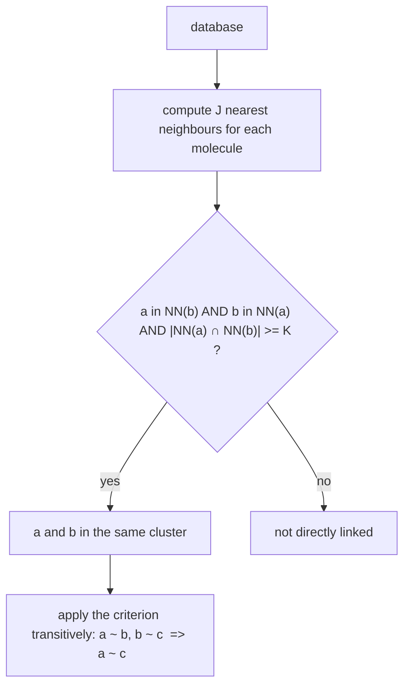

# Jarvis–Patrick Clustering

A clustering method based not on distances directly but on **shared nearest neighbours**:
two molecules belong to the same cluster if they are in each other's neighbour list and
share enough neighbours.

## Algorithm

```text
ALGORITHM JarvisPatrick(database, J, K)
  1. compute the nearest-neighbour list of length J for every molecule in the DB

  2. two molecules a, b are in the same cluster if:
        - a is in the NN list of b
        - b is in the NN list of a
        - a and b have at least K of their J NN-list elements in common
```


*Mutual membership plus a shared-neighbour count, closed transitively into clusters.*

## Transitivity

> The criterion is applied **transitively**:
>
> `a ~ c` if there are `b₁, …, b_k` with `a ~ b₁, b_i ~ b_{i+1}, b_k ~ c`

This is what turns a pairwise relation into clusters: the clusters are the connected
components of the "same cluster" relation.

**Extension:** consider only pairs with **similarity > τ**, to stop chains of weakly related
molecules from fusing distinct clusters.

## Why it matters

Unlike [[concepts/hierarchical-clustering]] and [[concepts/k-means-clustering]],
Jarvis–Patrick needs neither a cluster count nor a linkage choice, and it handles clusters
of very different density, because "close" is defined *relative to each molecule's own
neighbourhood* rather than by a global distance threshold.

## Caveats

- The result depends on two integers `J` and `K`, whose good values are dataset-specific.
- Transitive closure can chain clusters together (the classic single-linkage failure mode),
  which is precisely what the similarity threshold `τ` is there to limit.

## See also

- [[concepts/clustering-of-molecules]]
- [[concepts/hierarchical-clustering]]
- [[concepts/k-means-clustering]]

## Sources

- [[sources/ciw-04-descriptor-evaluation-clustering-and-superposition]] (p. 10)
