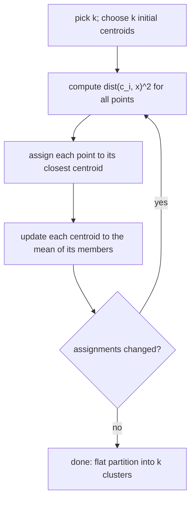

# k-Means Clustering

The standard **non-hierarchical** method: split `N` objects into `k` clusters by alternating
between "compute a mean per cluster" and "assign every object to the nearest mean".

> **Based on local optimisation.**

## The two-step loop

```text
repeat:
    compute a mean value for each cluster        # based on the cluster membership
    assign every object to the cluster with the most similar mean
```

## Detailed algorithm

```text
ALGORITHM k-Means(data, k)
  I)   pick k, the number of clusters
  II)  select k data points as cluster centres (centroids)  C = {c₁, …, c_k}
  III) distance between each point and the centroid,  dist(c_i, x)²
  IV)  assign each data point to the closest centroid
  V)   update centroids:
           c_i = (1 / |S_i|) · Σ_{x_j ∈ S_i} x_j
  repeat III–V until stable
```


*Assign, re-average, repeat — each step can only decrease the objective, so the loop terminates.*

## Problems

| Problem | Why it hurts |
|---|---|
| **Number of clusters `k`** | must be fixed in advance, and the "right" `k` is usually unknown |
| **Initial assignment** | different starts give different results (local optimisation!) |
| **Optimisation procedure** | converges to a local, not a global, optimum |

Note the contrast with [[concepts/hierarchical-clustering]]: k-means is cheap and scalable
but needs `k`; hierarchical clustering needs no `k` but produces a dendrogram that has to be
cut somewhere anyway.

**k-means is not hierarchical** — it yields a flat partition with no nesting.

## See also

- [[concepts/clustering-of-molecules]]
- [[concepts/hierarchical-clustering]]
- [[concepts/jarvis-patrick-clustering]]
- [[concepts/kohonen-maps]]
- [[exercises/ciw-e5-feature-trees]]

## Sources

- [[sources/ciw-04-descriptor-evaluation-clustering-and-superposition]] (p. 11)
