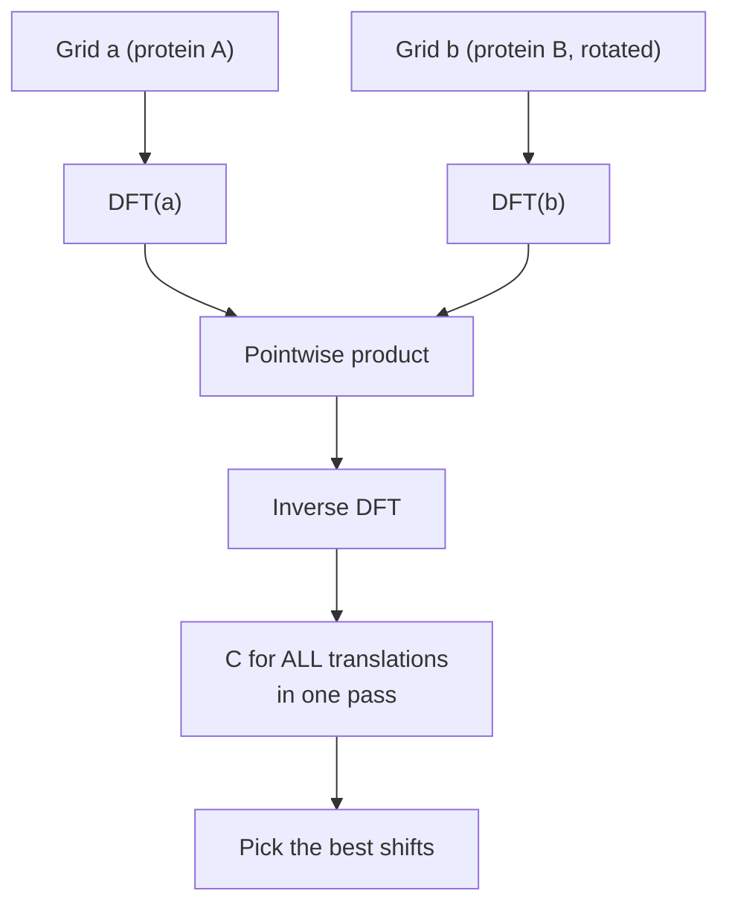

# Katchalski-Katzir algorithm

The classic FFT-based [[concepts/protein-protein-docking|protein–protein docking]] method:
represent both proteins on a 3D grid, express surface complementarity as a correlation, and
evaluate all translations at once by Fourier transform.

## Why it matters

The global search over all relative orientations is the bottleneck of protein–protein
docking. Katchalski-Katzir splits it into rotation and translation, and then makes the
translation part essentially free — the only place in the course where a frequency-domain
trick supplies the speed-up.

## Grid representation

```text
REPRESENTATION OF THE PROTEINS ON A 3D GRID

              ⎧ 1  : point (l,m,n) lies ON THE SURFACE
    a_{l,m,n} = ⎨ p  : point (l,m,n) lies INSIDE the protein
              ⎩ 0  : point (l,m,n) lies OUTSIDE the protein

    protein A:  p ≪ 0        (large negative core)
    protein B:  0 < p < 1    (small positive core)
```

The encoding is the whole idea. In the correlation below, each overlapping grid point
contributes `a · b`:

| A's point | B's point | product | interpretation |
|---|---|---|---|
| surface (1) | surface (1) | +1 | contact — rewarded |
| core (p ≪ 0) | core (0<p<1) | large negative | interpenetration — heavily punished |
| core (p ≪ 0) | surface (1) | large negative | B's surface inside A — punished |
| outside (0) | anything | 0 | neutral |

So one arithmetic expression simultaneously rewards surface contact and forbids overlap.

## Searching the complex

```text
SEARCH FOR THE PP COMPLEX

  ROTATION    : sampling; recompute b and optimise the
                translation for EACH rotation
  TRANSLATION : optimise over the shift (α,β,γ)

      C_{α,β,γ} = Σ_l Σ_m Σ_n  a_{l,m,n} · b_{l+α, m+β, n+γ}

  naive cost: O(n^6)

  → C becomes LARGER the larger the common contact surface
    and the smaller the overlap volume
```

## The Fourier trick

```text
FOUNDATIONS OF THE TRANSLATION OPTIMISATION

IDEA: TRANSFORMATION
    an invertible conversion of the data / of a function
    that permits a fast execution of an operation

CONVOLUTION
    describes the overlap between two functions f and g
    with offset h:
        c(h) = Σ_n f(n) · g(n+h)        ,     c = f * g

FOURIER TRANSFORMATION
    a sum of sine functions with varying wavelengths
    → (Discrete) Fourier Transformation (DFT)

    DFT(f * g) = DFT(f) · DFT(g)        ⇒ the translation search

RUNTIME
    DFT : O(n log n)
    ⇒ total:  O( N_R · N³ · log N )     (N_R = number of rotations)
```


*The convolution theorem turns an O(n^6) scan over translations into one pointwise multiplication in frequency space.*

Note precisely what is accelerated: **all translations for one fixed rotation** are obtained
in a single transform. Rotations are still sampled one by one, which is why `N_R` remains a
separate factor in the runtime.

## Caveats

- Rigid-body only: no backbone or side-chain flexibility, hence the need for "soft docking"
  (tolerating small clashes) in practice.
- Grid resolution trades accuracy against cost; the whole scheme inherits the grid
  sensitivities noted in [[concepts/ligsite-and-pocket]].
- Pure shape complementarity — no electrostatics, no [[concepts/hydrogen-bond]] geometry, no
  desolvation. The output is a list of candidates that must be rescored.
- Rotation sampling is the remaining bottleneck and is not accelerated at all.

## See also

- [[concepts/protein-protein-docking]]
- [[concepts/surface-reduction-for-docking]]
- [[concepts/monte-carlo-protein-docking]]
- [[concepts/molecular-surfaces]]
- [[concepts/scoring-functions]]

## Sources

- [[sources/ciw-06-flexible-docking-binding-sites-and-fragment-spaces]] (pp. 25–26)
