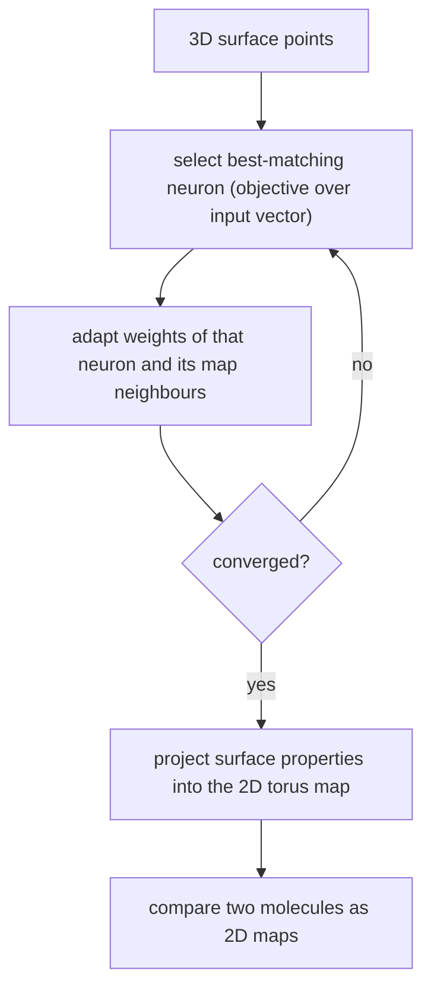

# Kohonen Maps for Surface Projection

Self-organising maps (Gasteiger, Zupan) used to **project a 3D molecular surface into 2D
while preserving local neighbourhoods**, so that two molecules can be compared as flat
images.

## Why it matters

Comparing two [[concepts/molecular-surfaces]] in 3D requires solving a superposition
problem. A Kohonen projection sidesteps it: once both surfaces are mapped onto the same 2D
torus, comparison is a pixel-wise operation.

## Setup

| Element | Definition |
|---|---|
| **Basic topology** | a 2D grid with **cyclic boundary conditions** (a torus) |
| **Application** | 2D projection of a 3D molecular surface, to simplify molecule comparison |
| **Learning phase** | assigns every point on the surface to a grid point of the Kohonen map |
| **Initialisation** | random |

The torus topology is essential — a closed molecular surface has no boundary, so the target
grid must have none either.

## Learning process

```text
ALGORITHM Kohonen-Train(surface points, map)
  initialise the map randomly
  repeat for each surface point v (the input vector):
      1. select a neuron by an objective function over the input vector
         (i.e. the best-matching unit, by coordinates)
      2. adapt the weight vectors of the selected neuron
         and of its neighbours in the map
  finally: project the surface properties into the map
```


*Iterative competitive learning; neighbourhood adaptation is what preserves locality in the projection.*

## Caveats

- The lecture notes specify the objective function only as "over the input vector
  (coordinates)" — see [[open-questions]].
- Random initialisation means the projection is not unique; two runs on the same molecule
  can give different maps, so a canonical orientation step is needed before comparison.

## See also

- [[concepts/molecular-surfaces]]
- [[concepts/connolly-surface-algorithm]]
- [[concepts/feature-trees]]

## Sources

- [[sources/ciw-03-pattern-mining-diagrams-surfaces-and-reduced-graphs]] (p. 18)
