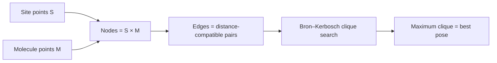

# Kuhl algorithm (docking graph)

The formalisation of rigid-body docking as a **maximum-clique problem** in a docking graph.

## Why it matters

Kuhl states cleanly what [[concepts/dock-algorithm]] does implicitly, and gives the pattern
its final form. It is the third appearance of the distance-compatibility graph in this
course, after [[concepts/disco-algorithm]] and DOCK.

## Problem statement

```text
DOCKING PROBLEM
   GIVEN   site points S, molecule points M
   SEARCH  a transformation (R, t) that MAXIMISES |C|, where

        C = { (s,m) ∈ S × M  |  s = R·m + t }
```

## The docking graph

```text
NODES : matches  S × M
EDGES : distance-compatible matches
        (s1,m1) — (s2,m2)   ⟺   | d(s1,s2) − d(m1,m2) | < ε

⇒ CLIQUES describe distance-compatible MATCHINGS
```


*A clique is a set of correspondences that can all be realised by one rigid transformation.*

The reason cliques are the right object: a rigid motion preserves distances, so any set of
correspondences realisable by a single (R,t) must be pairwise distance-compatible — and
conversely, pairwise compatibility is enough to recover (R,t) by
[[concepts/rmsd-and-point-set-superposition]].

## Clique search

```text
CLIQUE SEARCH with the BRON–KERBOSCH algorithm:
    exclusion of energetically unfavourable matches via the "not" set
    (i.e. select the node earlier so that it is moved into 'not')
```

This is a neat trick: Bron–Kerbosch already maintains a `not` set of vertices that must be
excluded from the current branch, so chemistry-based rejection costs nothing extra — an
energetically impossible match is simply placed there.

```text
BronKerbosch(R, P, X):          // R = current clique, P = candidates, X = "not"
    IF P = ∅ AND X = ∅: report R
    FOR v IN P:
        BronKerbosch(R ∪ {v}, P ∩ N(v), X ∩ N(v))
        P := P \ {v}
        X := X ∪ {v}            // ← energetically unfavourable matches
                                //   are seeded into X from the start
```

## Runtime

```text
→ clique search is NP-hard, the BK algorithm is exponential,
  BUT in general this does not hold for the docking problem
```

The docking graph is not an arbitrary graph: its nodes carry geometry, and distance
compatibility is highly constrained in 3D, so the cliques stay small and few. The notes
assert this without proof → [[open-questions]].

## Caveats

- Rigid-body only.
- The ε tolerance again controls the trade-off between missed and spurious matchings.
- Maximising |C| maximises the *number* of matched points, which is a shape criterion, not
  an energy — the pose still has to be ranked by [[concepts/scoring-functions]].

## See also

- [[concepts/docking]]
- [[concepts/dock-algorithm]]
- [[concepts/disco-algorithm]]
- [[concepts/clix-algorithm]]
- [[concepts/rmsd-and-point-set-superposition]]

## Sources

- [[sources/ciw-05-pharmacophores-qsar-and-docking]] (p. 28)
