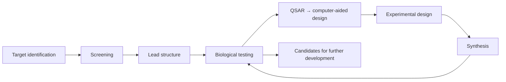
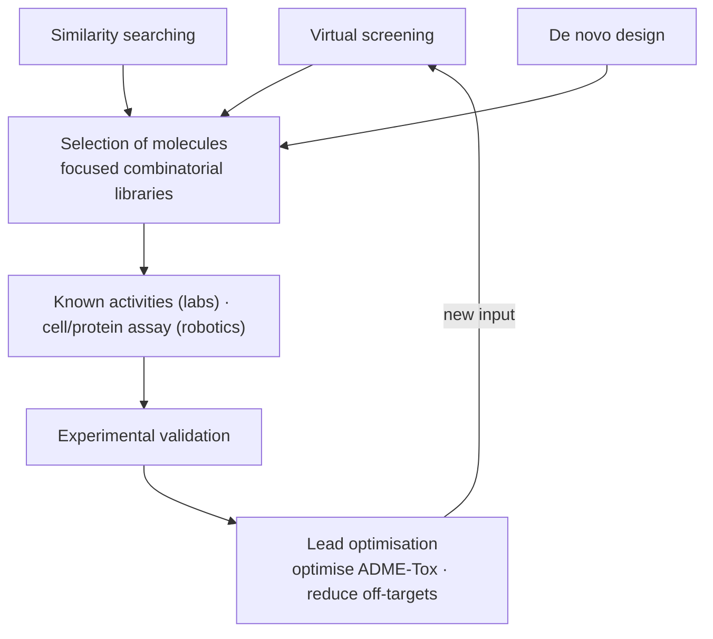

# Lead Finding Strategies

The five routes to a lead structure, and the design cycle they all feed.

## The design cycle

*Lead finding is a loop: design → synthesis → biological testing → QSAR → design.*

## The five strategies

| Strategy | Requires | Computational role |
|---|---|---|
| **Traditional design** | known activities, biology labs | minimal |
| **Screening** | cell/protein assay, robotics | data analysis |
| **Virtual screening** | 3D structure of the target, computers | docking, scoring |
| **Similarity searching** | known activities, computers | QSAR |
| **De novo design** | 3D structure of the target, computers | fragment assembly |

All of them are followed by **experimental validation** and then **lead optimisation**.

### Traditional design

- Successive modification / optimisation of known active compounds.
- Sources of initial active compounds:
  - constituents of plants
  - animal poisons and active substances
  - active substances from microorganisms

### (High-throughput) screening

See [[concepts/high-throughput-screening]].

### Virtual screening

See [[concepts/virtual-screening]].

### De novo design

See [[concepts/de-novo-design]].

## Current strategy in practice

*The three computational strategies feed a focused library, which is validated experimentally and then optimised.*

## See also

- [[concepts/virtual-screening]]
- [[concepts/de-novo-design]]
- [[concepts/high-throughput-screening]]
- [[concepts/drug-discovery-pipeline]]
- [[concepts/lead-optimization-heuristics]]

## Sources

- [[sources/ciw-01-drug-action-and-molecular-interactions]] (pp. 18–19)
