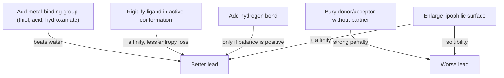

# Lead Optimization Heuristics

Rules of thumb for using intermolecular interactions as the basis for drug optimisation —
each one stated together with its caveat, because none of them is unconditional.

## The five rules from lecture 1

1. **Strong binders are characterised by large lipophilic contact surfaces**, but enlarging
   this surface is **no panacea**, because the solubility of the compound decreases.
2. **Additional hydrogen bonds do not necessarily lead to higher binding affinity**
   (desolvation + enthalpy–entropy compensation).
3. **Hydrogen-bond acceptors and donors should not be buried without being able to form a
   hydrogen bond.** If the ligand can form a *more optimal* hydrogen-bond network than water,
   this leads to high binding affinity (observe the **H-bond balance sheet**).
4. **Rigid ligands** (fixed in the active conformation) **bind more strongly than flexible
   ligands.** *Caution*: flexible ligands do not adopt every possible conformation in water
   either.
5. **Metal ions**: thiols, acids and hydroxamates are better binders than water, which can
   lead to strong binding.


*Every heuristic is a trade-off; only rules 3–5 are close to unconditional.*

```text
ALGORITHM EvaluateModification(ligand L, modification m, pocket P)
  INPUT : proposed chemical change
  OUTPUT: accept / reject with reason

  if m enlarges lipophilic surface:
      if predictedSolubility(L + m) < threshold: reject "insoluble"
  if m adds an H-bond donor/acceptor:
      if not partnerAvailable(P, m): reject "buried polar atom without partner"
      if HBondBalance(L + m, P) <= 0: reject "compensated by desolvation"
  if m rigidifies L into the bound conformation: accept "entropy gain"
  if m adds a metal-binding group and P contains a metal ion: accept "beats water"
```

## See also

- [[concepts/enthalpy-entropy-compensation]]
- [[concepts/hydrogen-bond]]
- [[concepts/hydrophobic-effect]]
- [[concepts/ionic-interactions-and-metal-complexation]]
- [[concepts/drug-discovery-pipeline]]

## Sources

- [[sources/ciw-01-drug-action-and-molecular-interactions]] (p. 17)
