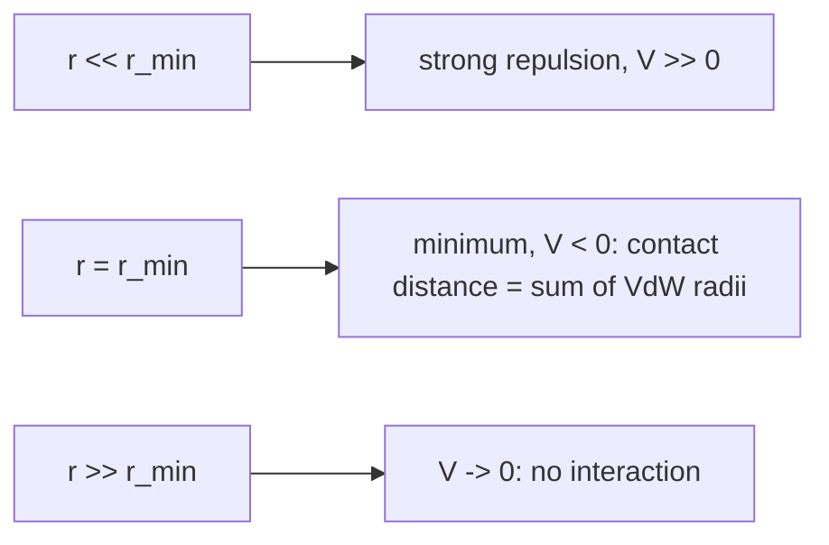

# Lennard-Jones Potential

The standard empirical model of the **van der Waals interaction** between two non-bonded
atoms, and the source of the atomic radius on which every
[[concepts/molecular-surfaces]] definition rests.

## The van der Waals interaction

Two contributions:

- dipole–dipole / induced-dipole interaction
- dispersion interaction (London forces)

Both are weak and short-ranged — see [[concepts/intermolecular-interactions]] for how they
compare to hydrogen bonds and ionic interactions.

## The potential

```text
V_ij(r) = A_ij / r^12  −  B_ij / r^6
```

| Symbol | Meaning |
|---|---|
| `r` | distance between two **non-bonded** atoms `i`, `j` |
| `A_ij`, `B_ij` | parameters depending on the elements of the atoms involved |
| `−B/r⁶` | attractive dispersion term |
| `+A/r¹²` | repulsive term (Pauli repulsion at short range) |

```text
 V(r)
   |  \
   |   \            r < r_min : repulsion dominates (A/r^12)
   |    \
 0 +-----\------------------------------> r
   |      \      __------------
   |       \__--/
   |         ^
   |      r_min = sum of the VdW radii   (V minimal)
```


*Steeply repulsive at short range, a minimum at the contact distance, then decaying to zero.*

## Consequences

- The **minimum** of the potential lies at the sum of the **van der Waals radii** of the
  atoms — this is the distance at which the VdW forces just balance.
- Intuition: **molecules do not approach each other more closely than this.**
- ⇒ each atom can be modelled as a **sphere of its VdW radius**, which is exactly the input
  to the surface definitions in [[concepts/molecular-surfaces]].

## United-atom radii model

Hydrogen atoms bound to carbon are **not modelled explicitly**; instead the radius of the
carbon is enlarged to absorb them. This roughly halves the number of spheres to process,
and the hidden hydrogens are non-polar anyway, so nothing chemically interesting is lost.

## Caveats

- `r^12` has no physical justification — it is chosen because it is the square of `r^6` and
  therefore cheap to evaluate.
- The potential describes **non-bonded** atom pairs only; bonded and 1-3 pairs are handled
  by the bonded terms of a force field.

## See also

- [[concepts/molecular-surfaces]]
- [[concepts/intermolecular-interactions]]
- [[concepts/protein-ligand-binding]]
- [[concepts/hydrophobic-effect]]

## Sources

- [[sources/ciw-03-pattern-mining-diagrams-surfaces-and-reduced-graphs]] (p. 14)
