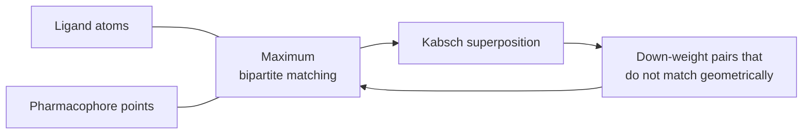

# LigandScout

A pharmacophore-matching algorithm that scores every (ligand atom, pharmacophore point)
pair and then solves a **maximum bipartite matching**, iterating until the geometric fit is
good enough.

## Why it matters

It replaces combinatorial backtracking with a polynomial-time matching problem, and then
repairs the geometry in an outer loop — the "approximate, then repair" pattern that also
governs [[concepts/structure-diagram-generation]] and [[concepts/connolly-surface-algorithm]].

## Mechanics

Pharmacophore points are first characterised by computing **distance histograms per
interaction type** — how far each interaction type typically sits from the others.

```text
ALGORITHM LigandScoutMatch
INPUT   pharmacophore P, molecule m
OUTPUT  a matching and a superposition

REPEAT:
    1. form ALL pairs (ligand atom a, pharmacophore point p)
       and score the fit(a,p)
    2. search the maximum bipartite matching M over these weighted pairs
    3. transform the molecule onto the pharmacophore     // Kabsch
    4. remove geometrically non-matching pairs by
       adjusting their fit values (penalise them)
UNTIL a matching with small enough deviation is found
⇒ heuristic
```


*Matching decides the correspondence, Kabsch decides the pose, and the geometric residual feeds back as an edge weight — repeat until convergence.*

Note the division of labour: the **combinatorics** is bipartite matching, the **geometry**
is the closed-form optimum of [[concepts/rmsd-and-point-set-superposition]]. Only the outer
loop is heuristic, and the notes mark it as such explicitly.

## Caveats

- Explicitly heuristic: no guarantee that the returned matching is optimal, and no
  guarantee of termination at a global optimum.
- Bipartite matching treats pairs independently; geometric consistency between pairs is
  only enforced indirectly, through the fit-value feedback.

## See also

- [[concepts/pharmacophore-matching]]
- [[concepts/rmsd-and-point-set-superposition]]
- [[concepts/pharmer-algorithm]]
- [[concepts/pharmacophore]]

## Sources

- [[sources/ciw-05-pharmacophores-qsar-and-docking]] (p. 7)
