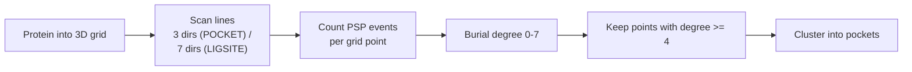

# POCKET and LIGSITE

Grid-based [[concepts/binding-site-detection|binding-site detection]] that finds pockets via
**burial information**, measured by protein–solvent–protein events along scan lines.

## Why it matters

The simplest workable formalisation of "a dent in the surface": a point is buried if, along
a straight line through it, you leave the protein, pass through empty space, and enter the
protein again. Counting how many independent directions show this pattern gives a scalar
*burial degree* that can be thresholded and clustered.

## Mechanics

```text
ALGORITHM Pocket / LIGSITE
INPUT : protein 3D structure
OUTPUT: potential active sites

  fit the protein into a 3D grid
  find buried positions on the protein surface with the help of
      PROTEIN–SOLVENT–PROTEIN (PSP) EVENTS

  POCKET  : scans in 3 directions (x, y, z)
  LIGSITE : scans in 7 directions (x, y, z + the 4 cubic diagonals)

  burial degree ∈ {0, ..., 7}
  cluster all points with burial degree ≥ 4
      → potential active sites
```


*A PSP event along a scan line is evidence of concavity; LIGSITE simply adds four diagonal directions to reduce orientation bias.*

A PSP event along one scan line:

```text
   protein  |  solvent  |  protein
   XXXXXXXX | ......... | XXXXXXXX
            ^-----------^
              this stretch of grid points scores +1
```

LIGSITE's contribution is precisely the extra four directions: with only the three axes, the
burial degree depends heavily on how the protein happens to be oriented in the grid. Seven
directions do not remove that dependence but substantially reduce it.

## Caveats

- Sensitive to grid width and to the position/orientation of the protein in the grid — the
  characteristic weakness of the whole grid family.
- The "pocket lid" (where the pocket stops and bulk solvent starts) has to be defined
  separately and is not determined by the burial count.
- Burial degree ≥ 4 is an arbitrary threshold.

## See also

- [[concepts/binding-site-detection]]
- [[concepts/surfnet]]
- [[concepts/drugsite]]
- [[concepts/molecular-surfaces]]
- [[concepts/marching-cubes]]

## Sources

- [[sources/ciw-06-flexible-docking-binding-sites-and-fragment-spaces]] (p. 9)
