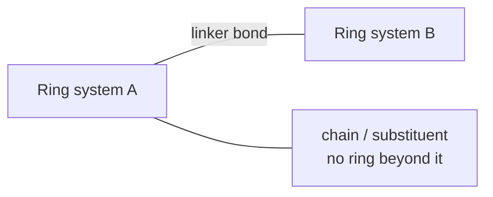

# Linkers and Chains

Once rings are known, the remaining acyclic bonds split into **linkers** (connecting two ring
systems) and **chains** (dangling substituents).

## Definition

> A bond is part of a **linker** iff removing it causes the molecule to split into multiple
> connected components that contain **at least one ring each**.

Everything else acyclic is a **chain**.


*A linker connects two ring-bearing fragments; a chain hangs off one.*

## Algorithm

```text
ALGORITHM GetDiverseAtomSets(Mol mol)
  INPUT : molecule
  OUTPUT: cyclic_atom_set, linker_set, chain_set

  lows        <- calculate_low_points(mol)        # number of rings if in a ring
  cyclic_bonds<- calculate_cyclic_bonds(mol)
  cyclic_atom_set <- {}
  for bond in cyclic_bonds:
      cyclic_atom_set.insert(bond.first)
      cyclic_atom_set.insert(bond.second)

  acyclic_bonds <- all bonds not cyclic
  linker_set <- {} ; chain_set <- {}

  for bond in acyclic_bonds:                      # search for linkers
      if bond.first == H or bond.second == H: continue      # ignore hydrogens
      # for both atoms check whether they are linkers or chains
      if is_linker(mol, bond.first, lows, cyclic_atoms): linker_set.insert(bond.first)
      else:                                              chain_set.insert(bond.first)
      if is_linker(mol, bond.second, lows, cyclic_atoms): linker_set.insert(bond.second)
      else:                                              chain_set.insert(bond.second)

  return cyclic_atom_set, linker_set, chain_set
```

```text
ALGORITHM is_linker_atom(Mol mol, Atom root, lows, cyclic_atoms)
  INPUT : candidate atom
  OUTPUT: true if root lies on a linker

  if not root.has_more_than_one_non_H_neighbors(): return false

  # 1) check whether every neighbour has at least one ring;
  #    count, for every neighbour, whether it reaches a ring
  ring_in_neighbors <- 0
  for neigh in root.Neighbors():
      has_ring <- false
      visited  <- [false, …]
      visited[root] <- true                       # visit every node except root
      dfs_ring_search(neigh, has_ring, visited, root, lows,
                      cyclic_atoms, first_found_ring_atoms)
      if has_ring: ring_in_neighbors++

  # 2) check whether at least two neighbours are no longer connected to each other;
  #    done by checking the first found ring atoms in the neighbour subgraph
  connected_components <- 0
  for start in first_found_ring_atoms:
      for end in first_found_ring_atoms:
          visited <- [false, …]
          visited[root] <- true
          dfs_find_atom(start, visited)
          if not visited[end]: connected_components++
  connected_components <- connected_components / 2 + 1

  ring_in_neighbors <- correct_ring_counts(ring_in_neighbors)
  return ring_in_neighbors == adjacency_count
```

The DFS in step 1 checks atoms for being cyclic and having a **different low point than the
root**, which is how the algorithm distinguishes "reaches a *different* ring system".

## Why it matters

Linker/chain/ring decomposition is the basis of **scaffold extraction** (Murcko frameworks),
fragment libraries for [[concepts/de-novo-design]], and diversity analysis of screening
libraries.

## See also

- [[concepts/biconnected-components-and-acyclic-bonds]]
- [[concepts/ring-perception]]
- [[exercises/ciw-e3-cycle-bases-and-linkers]]

## Sources

- [[sources/ciw-02-substructure-search-and-ring-perception]] (pp. 28–29)
