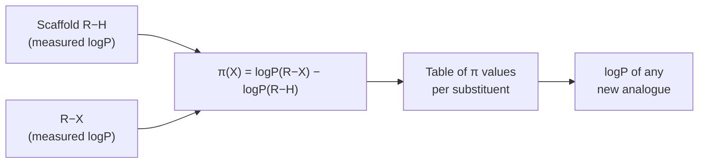

# Lipophilicity and logP

**P** is the partition coefficient of a molecule between octanol and water; **logP** is the
standard measure of lipophilicity.

## Why it matters

logP is the single most-used descriptor in drug design. It appears in the
[[concepts/admet]] boundary conditions of lecture 1, dominates
[[concepts/hansch-analysis]], and is the reason the hydrophobic contact surface has its own
term in Böhm's [[concepts/scoring-functions]].

## Measurement

Octanol is used as the solvent (Lösungsmittel) standing in for a lipophilic environment —
a cell membrane, or the interior of a binding pocket.

```text
P = [compound]_octanol / [compound]_water
logP = measure of lipophilicity
```

## Computation: additivity over groups

```text
logP is APPROXIMATELY ADDITIVE over the molecular groups.

Lipophilicity contribution of a group X:
        π(X) = logP(R−X) − logP(R−H)

π is determined EXPERIMENTALLY.

PROCEDURE:
    1. measure logP for the molecular base scaffold R−H
    2. compute logP for all molecules of the series from the π values
           logP(molecule) = logP(R−H) + Σ_substituents π(X)
```


*Measure once per substituent, then predict logP for the whole combinatorial series — additivity converts measurement into computation.*

This is the same additivity assumption that lecture 1 showed **fails** for binding free
energies ([[concepts/binding-thermodynamics]]). It survives here because partitioning
between two bulk phases has no cooperative binding site — there is nothing for the groups
to interact through.

## Caveats

- "Approximately additive" — proximity effects, intramolecular hydrogen bonds and
  conformational shielding all break it.
- π values are transferred between scaffolds without justification.
- logP describes the neutral species; for ionisable compounds the relevant quantity at
  physiological pH is logD.

## See also

- [[concepts/physicochemical-parameters]]
- [[concepts/hansch-analysis]]
- [[concepts/hydrophobic-effect]]
- [[concepts/admet]]
- [[concepts/lead-optimization-heuristics]]

## Sources

- [[sources/ciw-05-pharmacophores-qsar-and-docking]] (p. 16)
