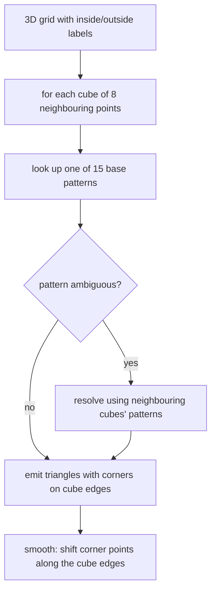

# Marching Cubes

Approximation of a surface **from grid data**: given a 3D grid whose points are labelled
inside/outside, produce a closed surface separating them.

## Problem statement

```text
given : a 3D grid with boolean values (inside / outside) at the grid points
sought: a closed surface separating the interior points from the exterior points
```

## Method

From every **8 neighbouring grid points (a cube)** a corresponding **surface segment** is
formed. The corner points of the segment lie **on the cube edges** — specifically on those
edges whose two endpoints have different labels.

There are `2^8 = 256` inside/outside assignments per cube, which reduce by symmetry to
**15 base patterns**.


*Each cube is classified independently, ambiguities are resolved against neighbours, and a final smoothing step moves the vertices along their edges.*

## Ambiguity

> Some inside/outside combinations admit **several** surface segments.

⇒ The **choice of pattern is made successively, on the basis of the grid points and of the
patterns of neighbouring cubes.** Without this, adjacent cubes can produce inconsistent
triangulations and the surface develops holes.

## Smoothing

Smoothing of the surface is achieved by **shifting the corner points along the cube edges**
— typically to the position where the interpolated field value crosses the threshold, which
turns a blocky lattice surface into a smooth isosurface.

## Caveats

- Resolution is bounded by the grid spacing; fine cavities below grid resolution vanish.
- Unlike [[concepts/connolly-surface-algorithm]], marching cubes is generic: it works for
  any scalar field (electron density, electrostatic potential), not only for a VdW/probe
  construction.

## See also

- [[concepts/molecular-surfaces]]
- [[concepts/connolly-surface-algorithm]]
- [[concepts/ball-pivoting-algorithm]]

## Sources

- [[sources/ciw-03-pattern-mining-diagrams-surfaces-and-reduced-graphs]] (p. 17)
