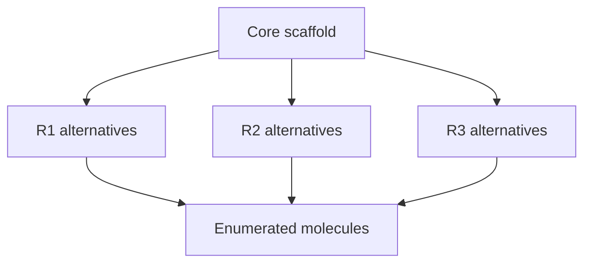

# Markush Structures

Markush structures represent a family of related molecules by a core scaffold with variable substituent positions.

## Why it matters

They are central to patent information systems because one patent can protect many related compounds without listing each molecule separately.

## How it works

```text
PROCEDURE EnumerateMarkush(core, positions)
  INPUT : core graph with variable positions R_i and substituent sets S_i
  OUTPUT: concrete molecules represented by the Markush structure

  molecules <- empty list
  for each combination (s_1 in S_1, ..., s_k in S_k):
      mol <- attach each s_i to position R_i on a copy of core
      if mol satisfies all constraints:
          add mol to molecules
  return molecules
```


*A Markush expression compresses a combinatorial set of concrete molecules.*

## Practical notes

- GCI lists Markush structures under patent information systems.
- They give compact representation and can cover many different molecules.

## Limitations / caveats

- Patent relevance depends on context and nomenclature as well as structure.
- Exact search may require resolving all substituent alternatives and constraints.

## See also

- [[concepts/chemical-databases-and-search-engines]]
- [[entities/chemical-database-catalog]]
- [[concepts/fragment-spaces]]

## Sources

- [[sources/gci-01-foundations-of-cheminformatics]] (p. 5)
