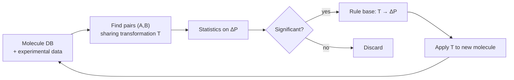
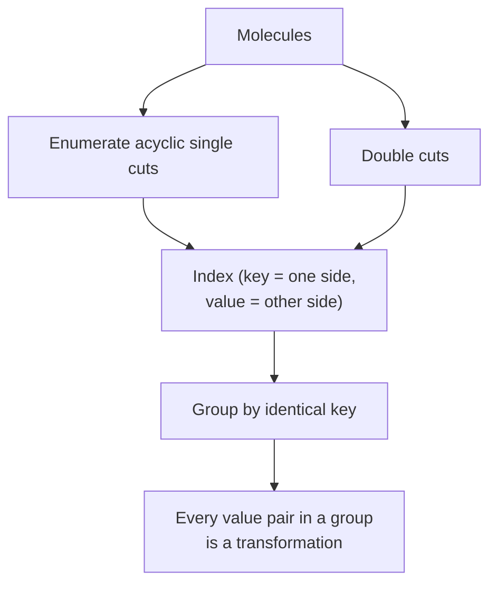

# Matched molecular pair analysis (MMPA)

The systematic extraction of transformation → property-change rules from a large molecular
database with experimental data.

## Why it matters

The goal, as the notes put it, is the **optimal use of information in large molecular
databases with experimental data**. Corporate compound collections contain millions of
measurements whose pairwise structure is never exploited; MMPA mines exactly that.

## Workflow

```text
ALGORITHM MMPA
INPUT   compound set with measured property P
OUTPUT  rule base of transformations

1. Search a set of molecule pairs (A,B) that differ by the SAME transformation T
2. Statistical investigation of the change ΔP over ALL pairs (A,B) sharing T
3. IF statistically significant:
       derive the rule   T → ΔP
       // i.e. if T is applied to a molecule X, we expect the property
       //      change ΔP for the resulting molecule
4. Build and maintain a rule base, classifying each rule as
       ↑ improvement | ⊙ consistent | ↓ detrimental
```


*The rule base is the persistent artefact; each new round of measurements feeds back and refines it.*

## The four MMP identification algorithms

```text
1) VIA SMILES
   user defines a substructure X as SMILES
   identify all molecules containing X
   for each molecule A: generate A−X by removing the substructure
   compare with B
   −  substructure X must be defined in advance; only limited fragments

2) VIA SMARTS
   user defines a possible transformation T as a SMARTS expression
   apply T to molecule A  →  compare with molecule B
   +  relatively efficient when index structures are used
   −  only transformations defined in advance by the user are identified

3) VIA MCS COMPUTATION
   compute the pairwise MCS T between ALL pairs (A,B)
   consider (A−T, B−T) and check the MMP properties:
       each is a connected subgraph, maximal number of atoms
   +  no advance definition of transformations
   −  very compute intensive

4) VIA FRAGMENT INDEXING (Hussain & Rea)
   cut all molecules at acyclic single bonds
   check the size of the fragments and build an index
   identify all pairs (A,B) with the same key value
   analogous algorithm for double cuts
   +  no advance definition of transformations, very fast
```

| Algorithm | Needs T in advance? | Cost |
|---|---|---|
| SMILES | yes (as substructure) | low |
| SMARTS | yes (as transformation) | low |
| MCS | **no** | very high |
| Fragment indexing | **no** | low |

Fragment indexing dominates: it is the only one that is both unsupervised and fast, which
is why it became the standard.

## Hussain & Rea in detail

```text
1) Take each input molecule and enumerate all acyclic SINGLE cuts
       A:  [□]−[△]    →    [□]-   and   -[△]
       B:  [□]−[○]    →    [□]-   and   -[○]

2) Index those cuts as (key, value) pairs, where the key is one side of
   the cut and the value are all possible other sides of the cut
       key [□]-   →   values  -[△], -[○]
       key -[△]   →   values  [□]-
       key -[○]   →   values  [□]-

3) Derive a transformation from shared keys
       -[△] >> -[○]      supported by MolA, MolB

DOUBLE CUTS: analogous, the key is the pair of exposed attachment points
       key  [□]- -[△]   →   value  [□]- -[○]-
       ⇒   -[□]- >> -[○]-     supported by MolC, MolD
```


*Indexing turns the quadratic pair search into a hash lookup — the same trick as fragment keys in [[concepts/pharmer-algorithm]].*

The critical insight is that finding pairs differing by *one* transformation becomes a
**group-by on a hash key**, avoiding the O(n²) all-pairs comparison that algorithm 3
requires.

## Caveats

- Cutting only at acyclic single bonds means ring transformations are invisible.
- Fragment-size filtering is required or the "transformation" can be most of the molecule.
- See the activity-prediction criticism in [[concepts/matched-molecular-pairs]].

## See also

- [[concepts/matched-molecular-pairs]]
- [[concepts/frequent-pattern-mining]]
- [[concepts/subgraph-isomorphism]]
- [[concepts/qsar]]
- [[exercises/ciw-e6-qsar-and-matched-molecular-pairs]]

## Sources

- [[sources/ciw-05-pharmacophores-qsar-and-docking]] (pp. 9–10)
