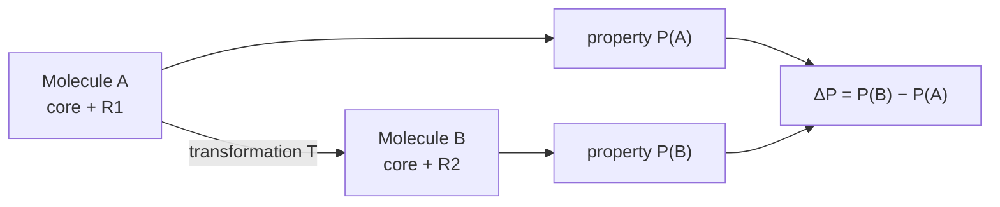

# Matched molecular pairs

A **matched molecular pair (MMP)** is a pair of molecules differing only by a particular,
small, well-defined structural transformation.

## Why it matters

MMPs answer the question that actually drives lead optimisation: *how does a change in
molecular structure affect a macroscopic property such as bioactivity?* Classical
[[concepts/qsar]] answers a harder question — predict the absolute property value — and the
MMP framing sidesteps it.

## Definitions

| Term | Definition |
|---|---|
| **MMP** | pair of molecules differing only by a particular (small) well-defined structural transformation |
| **MMPA** | Matched Molecular Pair Analysis: a systematic method to identify MMPs from a set of compounds and to determine the associated property change |
| **MMS** | Matched Molecular Series: a set of two or more molecules forming pairwise MMPs with identical scaffold |


*The unit of knowledge is not a molecule and not a descriptor — it is a transformation together with the property change it causes.*

## Core and context

- **Core** — the common structural component shared by the MMPs.
- **Context** — the surroundings around the core, i.e. the variations around it.

Both concepts are defined relative to the pair and are therefore **equal for both members**
of an MMP.

```text
Molecule A:   [====core====]--R1      context of R1 = core
Molecule B:   [====core====]--R2      context of R2 = core
transformation T:  R1 >> R2
```

## Advantages

1. **Predicting a property *difference* is easier than predicting the absolute value.**
   Systematic errors shared by both molecules cancel.
2. **Easily interpretable** — the output is a human-readable rule ("replace Cl by CF₃:
   +0.4 log units of solubility"), so the method learns from experience and examples in
   the way a medicinal chemist already reasons.

## Caveats

- The notes record a criticism: MMPA is weaker for predicting *biological activities*, and
  better suited to properties where the **same environment** applies — e.g. solubility in
  water. Biological activity depends on a binding site, which the core/context abstraction
  does not see.
- A rule derived on one chemical series need not transfer to another; MMPA has no mechanism
  guaranteeing transferability.

## See also

- [[concepts/matched-molecular-pair-analysis]]
- [[concepts/qsar]]
- [[concepts/lead-optimization-heuristics]]
- [[exercises/ciw-e6-qsar-and-matched-molecular-pairs]]

## Sources

- [[sources/ciw-05-pharmacophores-qsar-and-docking]] (pp. 8, 10)
