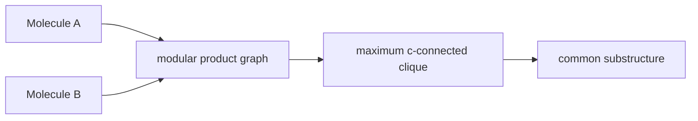

# Maximum Common Substructure

Maximum common substructure (MCS) is the largest graph pattern shared by two molecular graphs under chosen atom, bond, connectivity and inducedness rules.

## Why it matters

MCS is a similarity and alignment primitive: it identifies the conserved scaffold between two molecules, supports matched-fragment reasoning and connects [[concepts/subgraph-isomorphism]] to clique search.

## How it works

GCI part 3 distinguishes the variants before presenting algorithms:

- subgraph vs induced subgraph;
- connected vs disconnected common subgraph;
- ring and chain constraints;
- size objective by atom count or bond count.

For graphs `G1=(V1,E1)` and `G2=(V2,E2)`, the MCS problem asks for a connected graph `G12=(V12,E12)` with bijective embeddings into subgraphs of both inputs.

```text
PROCEDURE SpecifyMCSVariant()
  INPUT : two molecular graphs and chemical matching policy
  OUTPUT: precise MCS optimisation problem

  choose whether non-bonds must be preserved             # induced vs non-induced
  choose whether common subgraph must be connected
  choose whether rings and chains may be exchanged
  choose atom labels and bond labels to respect
  choose objective: maximise |V12| or maximise |E12|
```

```text
ALGORITHM ProductGraphMCS(G1, G2)
  INPUT : labelled molecular graphs G1 and G2
  OUTPUT: maximum common connected substructure

  P <- ModularProductGraph(G1, G2)
  clique <- maximum c-connected clique of P
  return decode each product vertex (u,v) as atom match u ↔ v
```


*The MCS search is transformed into a clique search on a compatibility graph.*

## MCIS and MCES

- **Maximum connected common induced subgraph (MCCIS/MCIS):** an edge exists in the common graph iff both original embeddings contain the edge; maximise atoms.
- **Maximum connected common edge subgraph (MCCES/MCES):** every common edge must map to an edge in both graphs; maximise bonds.

Line graphs reduce MCES to MCIS by turning original bonds into line-graph vertices. The notes cite Whitney's theorem: if two graphs are not related by a ΔY exchange, line-graph isomorphism corresponds to edge-isomorphism of the original graphs.

```text
PROCEDURE MCESviaLineGraph(G1, G2)
  INPUT : molecular graphs G1, G2
  OUTPUT: common edge subgraph

  L1 <- LineGraph(G1)          # one node per bond of G1
  L2 <- LineGraph(G2)          # line-graph edges connect incident original bonds
  C <- MCIS(L1, L2)
  decode nodes of C back to bonds of G1 and G2
```

## Limitations / caveats

- MCS is NP-hard.
- The chemical meaning depends on the chosen variant; the largest atom MCS and largest bond MCS can differ.
- ΔY exceptions are rare in chemical graphs according to the notes, but the source gives no concrete example.

## See also

- [[concepts/modular-product-graph]]
- [[concepts/bron-kerbosch-algorithm]]
- [[concepts/subgraph-isomorphism]]
- [[concepts/matched-molecular-pairs]]

## Sources

- [[sources/gci-03-stereochemistry-rings-substructure-and-mcs]] (pp. 26-28, 32)
