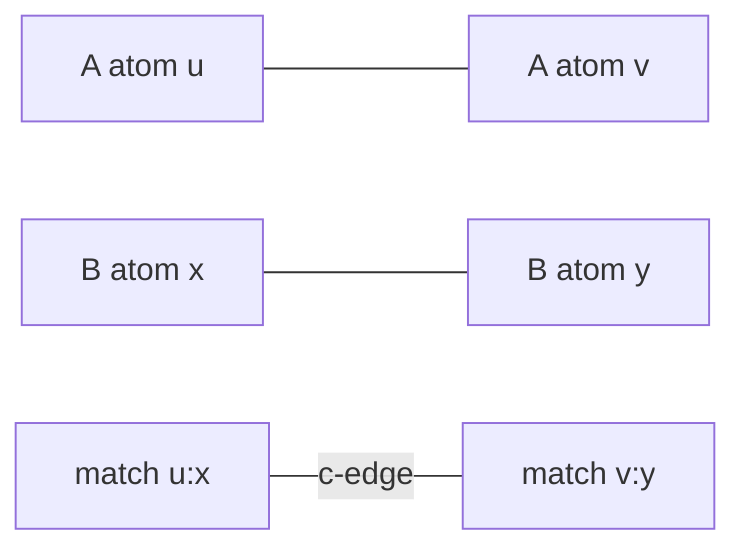

# Modular Product Graph

A modular product graph encodes compatible atom matches between two graphs so that common subgraphs become cliques.

## Why it matters

It is the central reduction from [[concepts/maximum-common-substructure]] to [[concepts/bron-kerbosch-algorithm]]: instead of searching two molecules directly, search one compatibility graph.

## How it works

For graphs `G1=(V1,E1)` and `G2=(V2,E2)`, create one product vertex for every compatible atom match `(u1,u2)` with matching labels. Two product vertices are adjacent if the pair of matches can coexist:

- **c-edge:** both original graphs contain the corresponding bond;
- **d-edge:** neither original graph contains the corresponding bond.

A set of product vertices describes a subgraph isomorphism when all matches are pairwise compatible, i.e. when they form a clique. For connected MCS, the clique must additionally be connected through c-edges.

```text
ALGORITHM ModularProductGraph(G1, G2)
  INPUT : labelled graphs G1=(V1,E1), G2=(V2,E2)
  OUTPUT: product graph P=(VP,EP) with c-/d-edge labels

  VP <- empty set
  for each u in V1:
      for each v in V2:
          if atomLabel(u) == atomLabel(v): add product vertex (u,v)

  EP <- empty set
  for each distinct product vertices (u1,u2), (v1,v2):
      if u1 == v1 or u2 == v2: continue       # injective mapping would be violated
      if (u1,v1) in E1 and (u2,v2) in E2:
          add c-edge between the product vertices
      else if (u1,v1) not in E1 and (u2,v2) not in E2:
          add d-edge between the product vertices
  return P
```

```text
PROCEDURE DecodeProductClique(clique C)
  INPUT : clique in modular product graph
  OUTPUT: atom mapping and common subgraph

  mapping <- { u ↔ v for each product vertex (u,v) in C }
  commonEdges <- pairs of mapped atoms linked by c-edges
  return mapping, commonEdges
```


*A c-edge says that two atom matches preserve a bond in both molecules.*

## Practical notes

- If only c-edges are used, the product graph finds common connected edge structure; d-edges additionally preserve non-bonds for induced variants.
- c-connected clique search keeps only cliques whose c-edge subgraph is connected.

## Limitations / caveats

- The product graph can be much larger than either molecule graph.
- The reduction transfers MCS hardness to maximum clique hardness; it does not make the problem polynomial.

## See also

- [[concepts/maximum-common-substructure]]
- [[concepts/bron-kerbosch-algorithm]]
- [[concepts/subgraph-isomorphism]]

## Sources

- [[sources/gci-03-stereochemistry-rings-substructure-and-mcs]] (pp. 28, 32)
