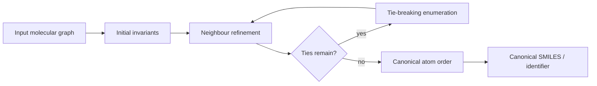

# Molecular Canonicalization

Molecular canonicalization assigns a deterministic atom order to a molecular graph so the same molecule receives the same identifier or string.

## Why it matters

A molecule can be drawn, numbered or traversed in many ways; without canonicalization, databases cannot reliably deduplicate records or compare [[concepts/smiles]] strings as identifiers.

## How it works

The source frames canonicalization as choosing an unambiguous atom order from the molecular graph. Traversal alone is not enough because different start atoms and neighbour orders can produce different linear strings.

```text
PROCEDURE CanonicalizeMolecule(G)
  INPUT : labelled molecular graph
  OUTPUT: canonical atom order and canonical line notation

  normalise atom and bond labels
  compute initial atom invariants from element, degree, bond order, charge and hydrogens
  refine the invariants through neighbouring atoms until stable
  if atoms remain tied:
      enumerate tie-breaking choices
      refine after each choice
      keep the lexicographically smallest complete ordering
  generate a line notation from the final order
  return order, string
```

```text
ALGORITHM BreadthFirstSearch(G, start)
  INPUT : graph G = (V,E), start atom
  OUTPUT: queue-based traversal order

  for each atom v: queued[v] <- false
  Q <- empty queue
  enqueue start; queued[start] <- true
  while Q is not empty:
      v <- dequeue Q
      append v to order
      for each neighbour w of v in the selected neighbour order:
          if not queued[w]:
              enqueue w; queued[w] <- true
  return order
  # complexity: O(|V| + |E|)
```


*Canonicalization turns a labelled graph into a deterministic order before string generation.*

## Practical notes

- Canonicalization is independent of the original atom numbering in a drawing or input file.
- The GCI notes use BFS as a general graph-ordering tool and then use Morgan/CANON-style refinement to minimise order ambiguity.
- Equivalent atoms in symmetric molecules require explicit tie-breaking; a local rule can be insufficient.

## Limitations / caveats

- Different toolkits can implement different canonicalization rules, so canonical strings are not necessarily portable across software.
- Tautomers, protonation states and mobile hydrogens must be normalised or represented in separate layers before canonical comparison.

## See also

- [[concepts/morgan-canonicalization]]
- [[concepts/canon-smiles-algorithm]]
- [[concepts/inchi-and-inchikey]]
- [[concepts/smiles-generation]]

## Sources

- [[sources/gci-02-inchi-canonical-smiles-and-smarts]] (pp. 7-16, 27-29)
