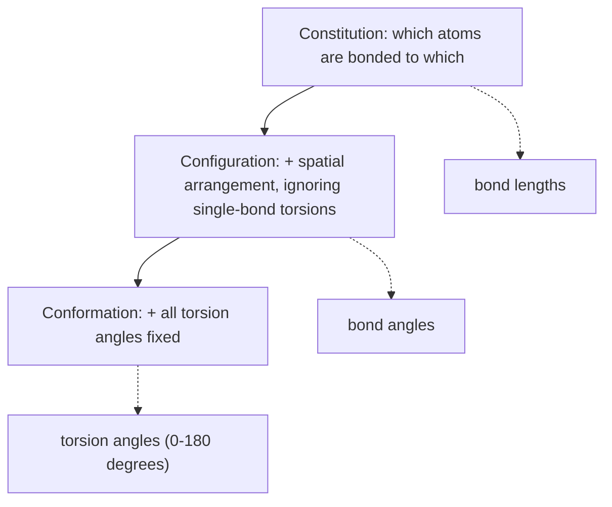

# Molecular Conformation and Geometric Parameters

The vocabulary needed before conformations can be generated: what exactly distinguishes two
3D structures of "the same" molecule.

## Structure generation

> Given the topology of a molecule, can we compute a *sensible* spatial molecular structure?
> → the structure with the **lowest, or at least a small, conformational energy**.

## The three levels

| Level | Definition |
|---|---|
| **Constitution** | the number and kind of the bonds between the atoms of the molecule |
| **Configuration** | the spatial arrangement of the atoms **without** taking the torsion angles about single bonds into account (*cis*/*trans*, L/R) |
| **Conformation** | the spatial arrangement of the atoms **including** the fixing of all torsion angles |

**Isomerism:** molecules with the same molecular formula and mass that may differ in their
constitution, configuration **and** conformation. (Compare the lecture-1 treatment in
[[concepts/molecular-structure-and-stereochemistry]].)

*Each level adds constraints; the geometric parameters attach to the level at which they become determined.*

## Geometric parameters

| Parameter | Definition | Determined by |
|---|---|---|
| **Bond length** | distance between two covalently bonded atoms | constitution / configuration |
| **Bond angle** | angle between two bonds at a central atom | constitution / configuration |
| **Torsion angle** | the angle between the two planes `X–A–B` and `A–B–Y`, spanned by the covalently bonded atoms `X–A–B–Y`; range 0°–180° | conformation |

The torsion angle is the only one of the three that is cheap to change at room temperature —
which is exactly why conformational search is a search over torsions
([[concepts/conformation-generation]]) and why [[concepts/protein-flexibility]] matters.

## See also

- [[concepts/vsepr-model]]
- [[concepts/conformation-generation]]
- [[concepts/molecular-structure-and-stereochemistry]]
- [[concepts/flexible-superposition]]

## Sources

- [[sources/ciw-04-descriptor-evaluation-clustering-and-superposition]] (p. 16)
