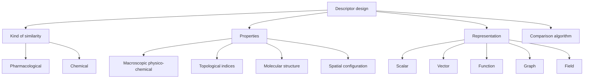

# Molecular Descriptors

Molecular descriptors are quantitative characterisations of molecules used to compare, model or predict molecular properties.

## Why it matters

Descriptors are the bridge from molecular graphs to [[concepts/molecular-similarity]], [[concepts/qsar]] and ligand-based [[concepts/virtual-screening]]. They decide what information a model can see and what it must ignore.

## How it works

GCI part 4 frames descriptor design as four linked decisions: the kind of similarity, the molecular properties to encode, the representation type and the comparison algorithm.


*Descriptor design fixes both what is measured and how the resulting object can be compared.*

```text
PROCEDURE ChooseDescriptorTask(task)
  INPUT : modelling or screening task
  OUTPUT: representation and comparison method

  decide whether similarity is pharmacological, chemical or another task-specific notion
  choose property family: physico-chemical, topological, structural or spatial
  choose representation: scalar, vector, function, graph or field
  choose comparison algorithm compatible with that representation
  validate whether the representation separates useful examples from decoys
```

## Practical notes

- Scalar descriptors such as [[concepts/topological-indices]] are compact but cannot be unique for complex molecules.
- Vector descriptors such as [[concepts/molecular-fingerprints]] support fast database search and many similarity coefficients.
- Richer representations require richer comparison algorithms; they are not automatically better.

## Limitations / caveats

- Descriptor choice can dominate the result: a comparison algorithm cannot recover information the descriptor never encoded.
- Similarity is representation-relative; two molecules can be similar under one descriptor and dissimilar under another.

## See also

- [[concepts/topological-indices]]
- [[concepts/molecular-fingerprints]]
- [[concepts/ecfp-and-fcfp-fingerprints]]
- [[concepts/similarity-and-distance-measures]]
- [[concepts/physicochemical-parameters]]

## Sources

- [[sources/gci-04-molecular-glues-descriptors-fingerprints-and-similarity]] (p. 3)
