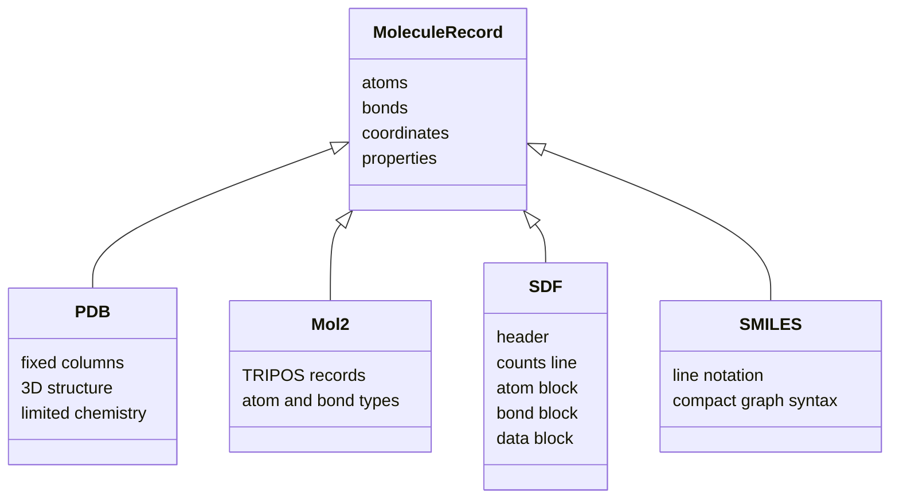
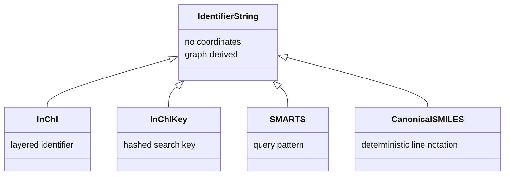

# Molecular File Formats

Molecular file formats encode a molecule's graph, coordinates and annotations in text records with format-specific information loss.

## Why it matters

Every database search and workflow begins by reading a file; if the format omits charge, hydrogens, stereochemistry or atom typing, downstream models inherit the ambiguity.

## How it works

```text
PROCEDURE ParseSDF(stream)
  INPUT : SD file stream
  OUTPUT: sequence of molecular records

  repeat until end of stream:
      header <- read molecule name, program/source/date and comment
      counts <- read atom count, bond count and flags
      atoms <- read counts.atomCount atom lines
      bonds <- read counts.bondCount bond lines
      properties <- read property block
      data <- read optional tagged data fields
      expect '$$$$' as molecule separator
      yield graph(atoms, bonds), properties, data
```


*File formats are alternative serialisations of a molecular record.*

## Identifier and query strings

GCI part 2 adds two string families that are not ordinary coordinate file formats:

| String | Role |
|---|---|
| [[concepts/inchi-and-inchikey|InChI]] | layered chemical identifier with formula, connectivity, hydrogens and optional stereo/isotope layers |
| InChIKey | fixed-length hashed lookup key derived from InChI |
| [[concepts/smarts|SMARTS]] | substructure query language based on SMILES syntax |
| canonical SMILES | deterministic toolkit-specific molecule string after canonicalisation |


*Identifier and query strings complement molecule record formats rather than replacing them.*

Source: [[sources/gci-02-inchi-canonical-smiles-and-smarts]] (pp. 1-23).

## Practical notes

| Format | Notes from GCI |
|---|---|
| PDB | ASCII, keyword/line-based fixed format; 3D structure but poor chemical information |
| mol2 | ASCII free format; rich 3D structure and chemical information; several records |
| SDF | ASCII fixed format; extendable by data fields; reliable in workflows |
| SMILES | compact molecular graph line notation |

## Limitations / caveats

- Missing information must be inferred, and inference can be wrong.
- PDB coordinates may not contain enough ligand chemistry for exact modelling.

## See also

- [[concepts/molecular-canonicalization]]

- [[concepts/smarts]]

- [[concepts/inchi-and-inchikey]]

- [[concepts/molecular-graphs]]
- [[concepts/smiles]]
- [[entities/chemical-database-catalog]]

## Sources

- [[sources/gci-01-foundations-of-cheminformatics]] (pp. 9–12)
