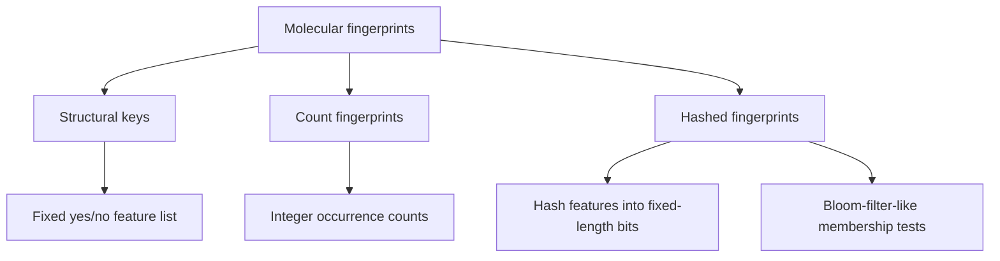

# Molecular Fingerprints

Molecular fingerprints encode a molecule as a bit or count vector of structural features.

## Why it matters

Fingerprints are the fast database-search representation behind [[concepts/molecular-similarity]], ligand-based [[concepts/virtual-screening]] and substructure prefilters. They trade chemical detail for vector operations that scale to large collections.

## How it works

GCI part 4 distinguishes structural keys, count fingerprints and hashed fingerprints.


*Fingerprint families differ mainly in whether features are predefined, counted or hashed into a fixed vector.*

### Structural keys

```text
PROCEDURE StructuralKey(M, featureList F)
  INPUT : molecule M, ordered feature list F = [G1, ..., Gn]
  OUTPUT: bit vector B

  for j in 1..n:
      if feature Gj occurs in M:
          B[j] <- 1
      else:
          B[j] <- 0
  return B
```

For substructure filtering, a query fingerprint bit required by the pattern but absent from the target proves that the pattern cannot match the target.

```text
PROCEDURE FingerprintSubstructureFilter(queryBits Q, targetBits T)
  INPUT : query and target structural-key bit vectors
  OUTPUT: reject or possible

  for each bit i:
      if Q[i] = 1 and T[i] = 0:
          return reject
  return possible       # possible means run exact subgraph isomorphism next
```

### Daylight-style hashed paths

```text
ALGORITHM DaylightPathFingerprint(M, minLen, maxLen, nBits)
  INPUT : molecule M and fixed fingerprint length nBits
  OUTPUT: bit vector B

  B <- all zeros
  paths <- enumerate molecular paths with lengths minLen..maxLen
  for each path p:
      c <- canonicalise p to an orientation-independent string
      seed <- convert c to an integer
      positions <- pseudoRandomPositions(seed, 4..5, nBits)
      for each pos in positions: B[pos] <- 1
  return B
```

## Practical notes

- Short fingerprints compare efficiently and need little storage.
- Longer fingerprints contain more groups and can be more selective.
- Count fingerprints store frequencies; binary fingerprints store only presence/absence.
- Hashed fingerprints have fixed length independent of the total number of possible features.

## Limitations / caveats

- Hashed bit positions cannot be uniquely mapped back to the exact originating structure.
- Collisions cause false positives, not guaranteed false negatives, in substructure prefilters.
- The central design problem is choosing the feature list or hash scheme; the list length fixes structural-key fingerprint length.

## See also

- [[concepts/ecfp-and-fcfp-fingerprints]]
- [[concepts/molecular-descriptors]]
- [[concepts/subgraph-isomorphism]]
- [[concepts/similarity-and-distance-measures]]

## Sources

- [[sources/gci-04-molecular-glues-descriptors-fingerprints-and-similarity]] (pp. 7-10)
