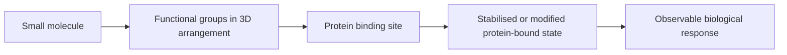

# Molecular Glues

A molecular glue (molekularer Klebstoff) is a small molecule that promotes or stabilises binding by presenting functional groups in a protein-compatible spatial arrangement.

## Why it matters

GCI part 4 uses molecular glues as the transition from exact molecular representation to [[concepts/protein-ligand-binding]]: a ligand matters because it can organise interactions with a protein, and similar arrangements can motivate [[concepts/molecular-similarity]] searches.

## How it works

The notes define the idea qualitatively: a molecule binds at or to a protein, relies on the specific spatial arrangement of functional groups, and can modify the protein-bound state. This is not presented as an algorithmic design method in the source, but as a binding concept that motivates descriptor-based comparison.


*A molecular glue is described through the spatial arrangement of groups that makes a protein-bound state possible.*

```text
PROCEDURE EvaluateMolecularGlueHypothesis(ligand L, protein P)
  INPUT : ligand L and candidate protein P
  OUTPUT: qualitative glue hypothesis

  groups <- identify functional groups on L
  arrangement <- describe relative positions of groups in space
  contacts <- test whether arrangement can make reversible contacts with P
  if contacts stabilise or modify the protein-bound state:
      return plausible molecular glue hypothesis
  else:
      return not supported by the available binding model
```

## Practical notes

- The source links molecular glues to spatially arranged functional groups rather than to a fixed scaffold.
- The protein context matters: the same functional groups are only meaningful if they can be presented to the relevant protein region.

## Limitations / caveats

- The notes do not give a named experimental example or a mechanistic subclassification.
- The exact protein or binding pose may be unknown, so subsequent similarity work is statistical rather than deterministic.

## See also

- [[concepts/protein-ligand-binding]]
- [[concepts/intermolecular-interactions]]
- [[concepts/molecular-similarity]]
- [[concepts/virtual-screening]]

## Sources

- [[sources/gci-04-molecular-glues-descriptors-fingerprints-and-similarity]] (p. 1)
