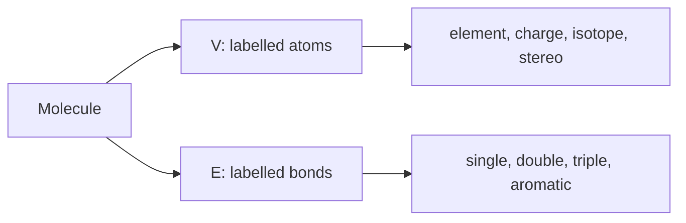

# Molecular Graphs

A molecular graph represents atoms as labelled vertices and covalent bonds as labelled edges.

## Why it matters

It is the common representation behind 2D structures, substructure search, molecular file formats, [[concepts/smiles]] and many descriptor algorithms.

## How it works

```text
PROCEDURE BuildMolecularGraph(atomLines, bondLines)
  INPUT : atom records and bond records from a molecular file
  OUTPUT: labelled graph G = (V, E)

  for each atom record:
      add vertex with element, charge, isotope, stereo and coordinates if present
  for each bond record:
      add edge between atom indices with bond order, stereo and topology labels
  return graph
```


*The molecular graph keeps topology and labels while drawing coordinates are optional data.*

## Graph traversals and atom order

GCI part 2 makes graph traversal operational: BFS visits atoms via a queue, DFS prints SMILES, and canonicalisation refines atom ranks until the graph can be serialised independently of input numbering.

```text
ALGORITHM BFSAtomOrder(G, start)
  INPUT : molecular graph and start atom
  OUTPUT: breadth-first atom order

  mark every atom as not queued
  enqueue start and mark it queued
  while queue is not empty:
      atom <- dequeue
      append atom to order
      for each neighbour in the chosen neighbour order:
          if neighbour is not queued:
              enqueue neighbour and mark it queued
  return order
```

Source: [[sources/gci-02-inchi-canonical-smiles-and-smarts]] (pp. 7-10).

## Practical notes

- GCI names identification, database search and syntax-based description as applications of 2D molecular graphs.
- Different file formats store different labels; missing labels may be inferred by chemical perception.

## Limitations / caveats

- A graph alone may omit stereochemistry, tautomers, protonation state or conformational information.

## See also

- [[concepts/smarts]]

- [[concepts/morgan-canonicalization]]

- [[concepts/molecular-canonicalization]]

- [[concepts/subgraph-isomorphism]]
- [[concepts/molecular-file-formats]]
- [[concepts/smiles]]
- [[concepts/ring-perception]]

## Sources

- [[sources/gci-01-foundations-of-cheminformatics]] (pp. 8, 14)
