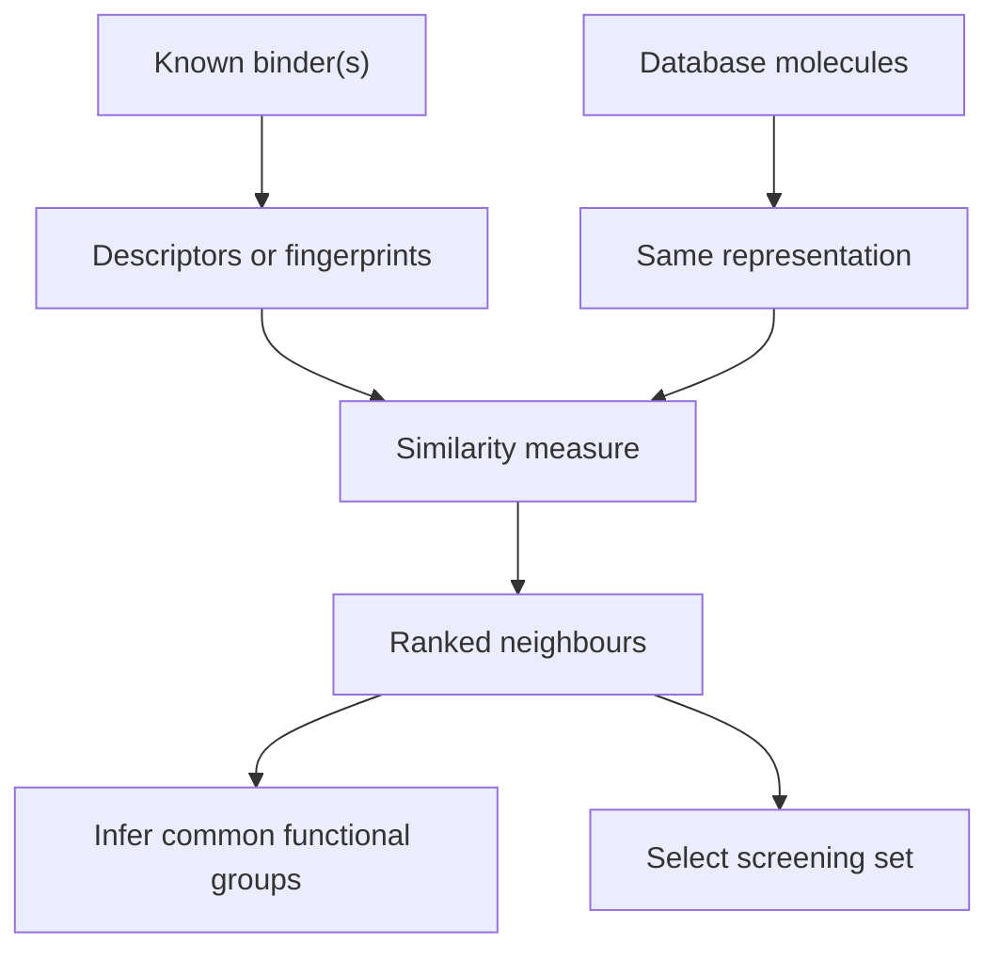

# Molecular Similarity

Molecular similarity is the comparison of molecules by chosen properties so that molecules close in representation are expected to behave similarly.

## Why it matters

Ligand-based [[concepts/virtual-screening]] works when at least one active molecule is known but the protein structure or exact binding mode is not. The similarity principle is then a statistical working assumption: similar physico-chemical properties imply similar binding behaviour more often than chance.

## How it works

The notes separate the idea from exact identity. Similarity can mean pharmacological similarity, where molecules behave similarly in biological systems, or chemical similarity, where molecules are built from similar functional groups. The output depends on the representation and the [[concepts/similarity-and-distance-measures]] used to compare it.


*Similarity searching turns known binders into a ranked database search and a hypothesis about relevant features.*

```text
PROCEDURE MolecularSimilaritySearch(known K, database D, representation R, similarity s)
  INPUT : known active molecules K, database D, representation function R, similarity s
  OUTPUT: ranked candidate list

  ref <- aggregate{R(k) for k in K}
  for each molecule m in D:
      x <- R(m)
      score[m] <- s(x, ref)
  ranked <- sort D by descending score
  return ranked
```

## Practical notes

- Starting point: one or more molecules with known binding properties for a target protein.
- Goals: find further molecules in a database, determine relevant functional groups, predict binding properties and choose a screening subset.
- Similarity can preserve a binding property while changing other parts of the molecule for optimisation.

## Limitations / caveats

- The source explicitly treats the method as only statistical when the protein is unknown.
- Unknown relevant groups and unknown binding poses mean small structural changes can still cause large affinity changes.
- Molecules may bind only partially in the same active-centre region, so global similarity does not guarantee the same interaction pattern.

## See also

- [[concepts/molecular-descriptors]]
- [[concepts/molecular-fingerprints]]
- [[concepts/ecfp-and-fcfp-fingerprints]]
- [[concepts/similarity-and-distance-measures]]
- [[concepts/virtual-screening]]

## Sources

- [[sources/gci-04-molecular-glues-descriptors-fingerprints-and-similarity]] (pp. 2-3)
