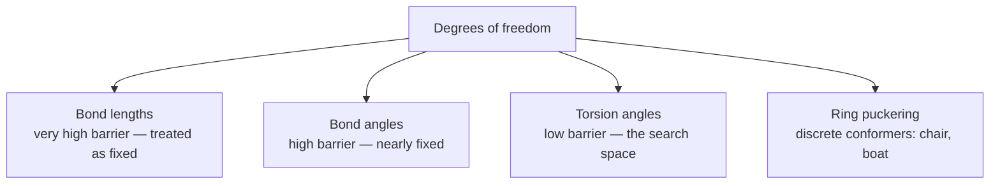
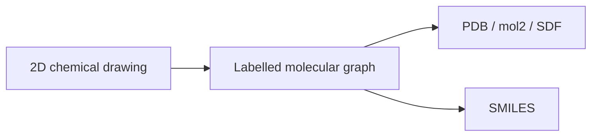
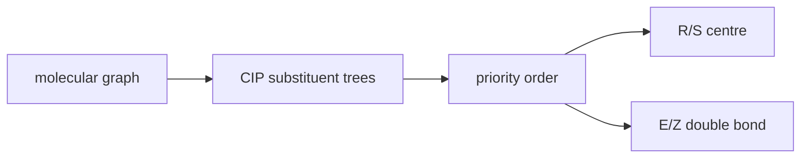

# Molecular Structure and Stereochemistry

How atoms, bonds, geometry and isomerism define a molecule — the chemical level on which
every molecular representation in cheminformatics is built.

## Molecular constitution

- **Molecule** — a set of covalently bonded atoms.
- **Organic elements** — C, O, N, H, S, P.
- **Covalent bond** — valence electrons are assigned to two spatially neighbouring atoms.
- **Bond types** — single, double, triple bond.
- Elements and bond types determine the **local geometry** at an atom via hybridisation:

| Hybridisation | Geometry | Typical bonding |
|---|---|---|
| sp³ | tetrahedral | four single bonds |
| sp² | trigonal planar | one double bond |
| sp | linear | one triple bond (or two double bonds) |

## 3D structure

- **Molecular conformation** — the 3D arrangement of the atoms.
- **Bond length** — depends on element and bond type; very high energy barriers.
- **Bond angle** — depends on the hybridisation state; high energy barriers.
- **Torsion angle** — rotation about a single bond; energy barriers determined by the groups
  rotating past each other. **This is the degree of freedom that conformational search explores.**
- **Ring systems** — e.g. chair and boat conformations.


*Conformational search effectively means sampling torsion angles and ring conformations.*

## Isomerism

- **Isomers** — same molecular formula, different structural formula.
- **Constitutional isomers (Strukturisomere)** — different molecular graph.
- **Geometric isomers** — cis/trans isomerism.
- **Stereoisomers (configurational isomers)** — same graph, different spatial configuration:
  - at a carbon with four different substituents → R/S
  - also in allenes and ring systems

```text
ALGORITHM ClassifyIsomerPair(mol A, mol B)
  INPUT : two molecules with identical molecular formula
  OUTPUT: isomer relationship

  if graph(A) != graph(B):
      return "constitutional isomers"
  if configuration(A) != configuration(B):
      if double-bond geometry differs: return "geometric (cis/trans) isomers"
      else:                            return "stereoisomers (R/S)"
  return "conformers"              # interconvertible by torsion rotation
```

## Representation bridge to graphs and line notations

GCI makes the representation step explicit: a 2D structure becomes a labelled graph, which can then be stored in file formats or linearised as [[concepts/smiles]].


*The same constitution can be drawn, stored as records or serialised as a string.*

Source: [[sources/gci-01-foundations-of-cheminformatics]] (pp. 8-14).

## Encoding stereochemistry in identifiers

GCI part 2 adds that InChI and SMARTS can encode stereochemical information in layers or primitives: E/Z-like double-bond stereochemistry, tetrahedral chirality, local chirality markers and isotopic substitution can be carried separately from heavy-atom connectivity.

```text
PROCEDURE AddStereochemicalIdentifierLayer(molecule M)
  INPUT : molecular graph with stereo annotations
  OUTPUT: stereo layer or empty layer

  for each double bond with defined geometry:
      record relative configuration
  for each tetrahedral stereocentre with defined neighbour order:
      record local configuration
  if no stereo is defined:
      return empty layer
  return stereo descriptors in canonical atom order
```

Source: [[sources/gci-02-inchi-canonical-smiles-and-smarts]] (pp. 2-4, 20).

## CIP priority as graph traversal

GCI part 3 makes stereochemical assignment algorithmic: before a tetrahedral centre can be labelled R/S or a double bond E/Z, substituents are ordered by [[concepts/cip-sequence-rules]]. The priority comparison walks outward from the stereochemical unit, compares atomic numbers and isotope masses, duplicates atoms for multiple bonds, and opens rings with duplicate nodes.

```text
PROCEDURE AssignCIPBasedStereo(molecule M, stereochemicalUnit s)
  INPUT : molecular graph with a tetrahedral centre or stereogenic double bond
  OUTPUT: R/S or E/Z descriptor when the drawing/3D orientation is defined

  substituents <- atoms directly attached to the stereochemical unit
  priorities <- CIPRankSubstituents(M, substituents)
  if s is tetrahedral:
      orient the lowest-priority substituent away from the viewer
      return R if 1 -> 2 -> 3 is clockwise, otherwise S
  if s is a double bond:
      compare the highest-priority substituent on each side
      return Z if they are on the same side, otherwise E
```


*Stereochemical labels are assigned only after graph-derived substituent priorities are known.*

Source: [[sources/gci-03-stereochemistry-rings-substructure-and-mcs]] (pp. 1-5).

## See also

- [[concepts/smarts]]

- [[concepts/inchi-and-inchikey]]

- [[concepts/cip-sequence-rules]]

- [[concepts/intermolecular-interactions]]
- [[concepts/protein-ligand-binding]]

## Sources

- [[sources/ciw-01-drug-action-and-molecular-interactions]] (p. 9)
- [[sources/gci-01-foundations-of-cheminformatics]] (pp. 8-14)
- [[sources/gci-02-inchi-canonical-smiles-and-smarts]] (pp. 2-4, 20)
- [[sources/gci-03-stereochemistry-rings-substructure-and-mcs]] (pp. 1-5)
