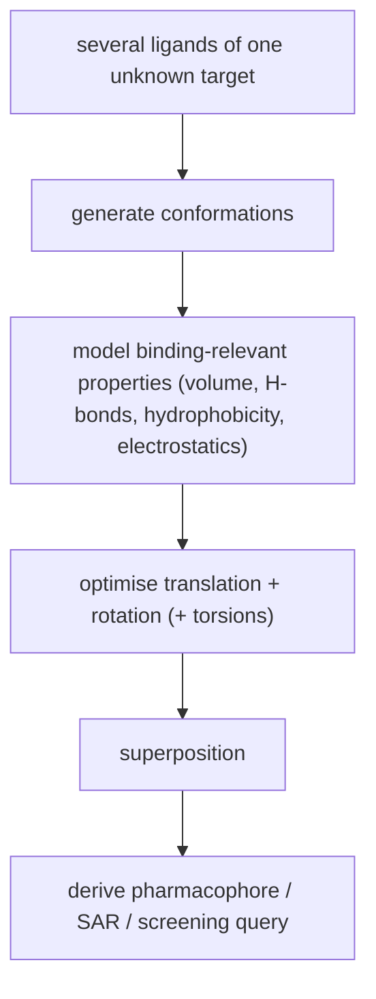

# Molecular Superposition (the Overlay Problem)

Given several ligands that bind to one protein **whose 3D structure is unknown**, find the
relative orientation of the ligands with respect to the target protein.

## Problem statement

```text
given  : several ligands that bind to a protein for which no 3D structure is known
sought : the relative orientation of the ligands with respect to the target protein
method : superpose the molecules so that as many binding-relevant properties as possible
         are brought into coincidence
             volume, H-bonds, hydrophobicity, electrostatics
```

This is the ligand-based counterpart of docking: if you cannot see the binding site, infer
it from the fact that all these molecules must fit into the *same* one.

## Problem variants

- taking the **conformational degrees of freedom** into account (**flexible** vs **rigid**)
- **multiple molecules** vs **molecule pairs**

## Problems

| Problem | |
|---|---|
| The **conformations** of the molecules are unknown | → [[concepts/conformation-generation]] |
| Molecules overlap **only partially** on binding | a global best fit is the wrong objective |
| The relevant groups / properties are **unknown** | → [[concepts/pharmacophore]] |
| A **complex optimisation problem** | continuous (pose) and discrete (conformer, matching) at once |


*Conformations in, a common frame out; the pharmacophore is read off the superposition.*

## Applications

- deriving **pharmacophores** from a database search
- **direct search** for similar molecules
- determining **structure–activity relationships (SAR, QSAR)**
- **evaluating HTS data** ([[concepts/high-throughput-screening]])

## See also

- [[concepts/gaussian-molecular-representation]]
- [[concepts/seal-algorithm]]
- [[concepts/flexible-superposition]]
- [[concepts/rmsd-and-point-set-superposition]]
- [[concepts/pharmacophore]]
- [[concepts/protein-flexibility]]

## Sources

- [[sources/ciw-04-descriptor-evaluation-clustering-and-superposition]] (p. 13)
