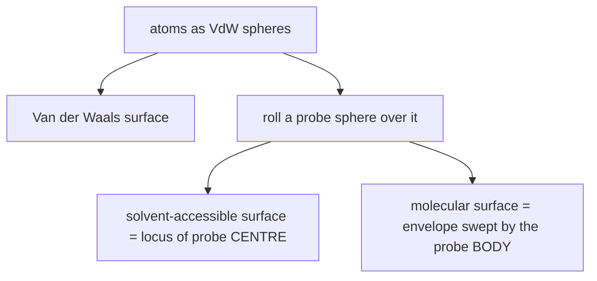

# Molecular Surfaces

Three nested definitions of "the surface of a molecule", all derived from modelling each
atom as a sphere of its van der Waals radius
([[concepts/lennard-jones-potential]]).

## Why it matters

> **Binding presupposes complementarity of the surfaces.**

- **Modelling:** design of molecules with surface complementarity
  → visualisation, and algorithms for docking and superposition.
- The interaction energy depends on the molecular surfaces, via
  - the change of the dielectric constant at the protein–solvent transition,
  - **desolvation** ([[concepts/desolvation-and-water]]),
  - the **hydrophobic effect** ([[concepts/hydrophobic-effect]]).

This makes the surface the geometric object that connects the thermodynamics of
[[concepts/protein-ligand-binding]] to something a computer can actually enumerate.

## Surface types

| Surface | Definition |
|---|---|
| **Van der Waals surface** | the union of the non-covered parts of the VdW spheres |
| **Solvent-accessible surface (SAS)** | the locus of the **centre** of a solvent sphere rolling on the VdW surface |
| **Molecular surface (Connolly / SES)** | the **roll surface** of a solvent sphere on the VdW surface |

⚠️ The VdW surface contains **very narrow cavities** into which no solvent molecule fits;
the other two definitions exist precisely to smooth those away.

*One probe sphere, two different traces: its centre gives the SAS, its body gives the molecular surface.*

## Patch types of the molecular surface

| Patch | Geometry |
|---|---|
| **Convex** | part of the surface of a sphere (an exposed atom) |
| **Saddle-shaped** | a torus (probe touching two atoms) |
| **Concave** | three bounding planes (probe touching three atoms) |

### Characterisation

- Convex and concave faces are each **surrounded by saddle faces**.
- The **corner points** of all faces are the contact points of the probe at positions with
  **three touching points** ⇒ a **discrete description by a graph is possible**.
- The surface is **continuous and differentiable**.
- ⚠️ **Problem: self-intersection of the surface** → *cusp trimming* removes such regions.

The "discrete description by a graph" is the key sentence: it turns a smooth geometric
object into a combinatorial one, and that is what [[concepts/connolly-surface-algorithm]]
traverses.

## Caveats

- The probe radius is a free parameter (conventionally 1.4 Å for water); the surface is not
  an intrinsic property of the molecule.
- Self-intersections occur in narrow clefts where the probe touches more than three atoms
  at once.

## See also

- [[concepts/lennard-jones-potential]]
- [[concepts/connolly-surface-algorithm]]
- [[concepts/marching-cubes]]
- [[concepts/ball-pivoting-algorithm]]
- [[concepts/kohonen-maps]]
- [[concepts/hydrophobic-effect]]
- [[concepts/desolvation-and-water]]

## Sources

- [[sources/ciw-03-pattern-mining-diagrams-surfaces-and-reduced-graphs]] (pp. 14–15)
