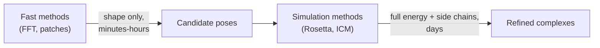

# Monte Carlo protein docking

Simulation-based [[concepts/protein-protein-docking|protein–protein docking]]: sample poses
stochastically and optimise them with full energy models, accepting runtimes of days.

## Why it matters

[[concepts/katchalski-katzir-algorithm|FFT]] and patch methods buy speed by simplifying the
scoring to shape complementarity. Simulation methods make the opposite trade: full energy
functions, explicit side-chain optimisation, and — critically — **side-chain flexibility**,
which shape-based methods cannot express at all.


*In practice the two are used in sequence: a fast global search proposes, a simulation refines.*

## RosettaDock

```text
RosettaDock
    1) rigid-body MONTE CARLO search        ⎫
    2) optimisation of the side chains      ⎬  DAYS
    3) final optimisation of the poses      ⎪
    4) clustering                           ⎭
```

Stages 2 and 3 are what the fast methods omit. Stage 4 is
[[concepts/pose-clustering]] again: stochastic search produces many near-duplicates, and
cluster size is itself evidence — a broad energy funnel indicates a real binding mode.

## ICM-DISCO

```text
ICM-DISCO
  - interaction energies are PRECOMPUTED ON GRIDS
  - starting points for the optimisation are placed on the
    protein surfaces at distances of about 15 Å
  - minimisation of ALL COMBINATIONS of starting points
  - side-chain optimisation for the best poses

  → 6–7 days
```

The grid precomputation is the trick that makes exhaustive minimisation affordable: the
protein's field is computed once, then every candidate reads it off — the same idea as the
precomputed grids of [[concepts/drugsite]] and [[concepts/comfa]]. The 15 Å spacing is a
compromise: dense enough that every binding mode is within reach of some starting point,
sparse enough that the number of combinations stays finite.

Note the name: this is *not* the pharmacophore DISCO of
[[concepts/disco-algorithm]] — an unfortunate collision of acronyms.

## Evaluation

Both are assessed in the CAPRI blind trials (~50 % success rate); see
[[concepts/protein-protein-docking]] for what succeeds and what does not.

## Caveats

- Days per complex: no screening application whatsoever.
- Stochastic, so results vary run to run; multiple runs and clustering are mandatory.
- Backbone still essentially rigid — only side chains move, so large induced fit is still
  out of reach.

## See also

- [[concepts/protein-protein-docking]]
- [[concepts/katchalski-katzir-algorithm]]
- [[concepts/randomised-docking]]
- [[concepts/pose-clustering]]
- [[concepts/protein-flexibility]]

## Sources

- [[sources/ciw-06-flexible-docking-binding-sites-and-fragment-spaces]] (p. 28)
