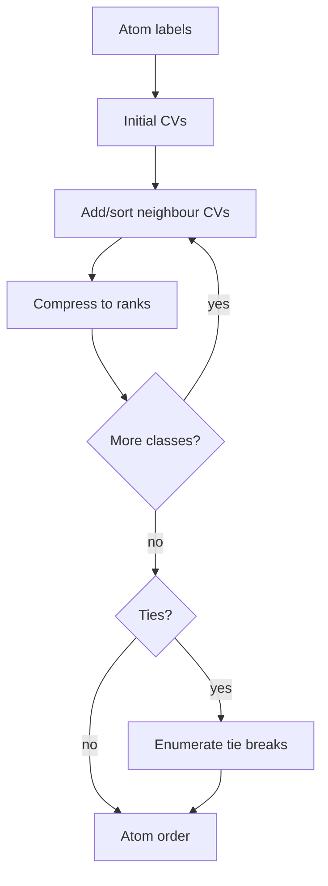

# Morgan Canonicalization

Morgan canonicalization iteratively refines atom connectivity values from neighbouring atoms to help derive a canonical atom order.

## Why it matters

Canonical [[concepts/smiles]] and [[concepts/inchi-and-inchikey]] connection layers need atom rankings that do not depend on how the molecule happened to be drawn or numbered.

## How it works

The notes present Morgan's method as repeated calculation of connectivity values (CVs). Initial values depend on the atom and its non-H bonding environment; each round replaces an atom's value by a combination of adjacent atom values. If equal CV patterns remain, all relevant tie-breaking possibilities may need to be considered.

```text
ALGORITHM MorganConnectivityValues(G)
  INPUT : labelled molecular graph G = (V,E)
  OUTPUT: connectivity values CV[v] for every atom

  for each atom v in V:
      CV[v] <- initialInvariant(v)     # element, non-H neighbours, bond orders, H count
  previousClassCount <- 0
  repeat at most |V| times:
      for each atom v in V:
          newCV[v] <- combine(CV[v], sorted{CV[w] for w in neighbours(v)})
      CV <- rankCompress(newCV)
      classCount <- number of distinct values in CV
      if classCount = previousClassCount:
          break
      previousClassCount <- classCount
  return CV
```

```text
PROCEDURE ResolveMorganTies(G, CV)
  INPUT : molecular graph and possibly tied CVs
  OUTPUT: one canonical order

  if all CVs are unique: return atoms sorted by CV
  choose the highest-priority tied class
  candidates <- empty list
  for each atom a in tied class:
      split a from the class
      recompute/refine CVs
      append resulting order to candidates
  return lexicographically minimal candidate order
```


*Morgan refinement propagates local atom environments outward until atom ranks stabilise.*

## Practical notes

- The notes use element priority such as `O > N > C` in examples, then further distinguish atoms by bond counts and neighbour CVs.
- Symmetric atoms can retain equal CVs; this is expected rather than an error.
- Morgan CVs are a canonicalization tool here, distinct from later circular fingerprints that also use Morgan-style neighbourhood growth.

## Limitations / caveats

- The notes explicitly include cases with duplicate element/CV patterns; refinement alone cannot always produce a complete unique order.
- The final result depends on the precise invariant and tie-breaking definitions used by the implementation.

## Relation to ECFP

GCI part 4 uses the same Morgan-style idea for [[concepts/ecfp-and-fcfp-fingerprints]]: atom identifiers are initialised locally and then iteratively updated from neighbouring atoms. The goal changes from canonical atom ordering to feature generation for similarity search.

## See also

- [[concepts/molecular-canonicalization]]
- [[concepts/canon-smiles-algorithm]]
- [[concepts/smiles-generation]]

## Sources

- [[sources/gci-02-inchi-canonical-smiles-and-smarts]] (pp. 8-13)
- [[sources/gci-04-molecular-glues-descriptors-fingerprints-and-similarity]] (pp. 9, 11)
