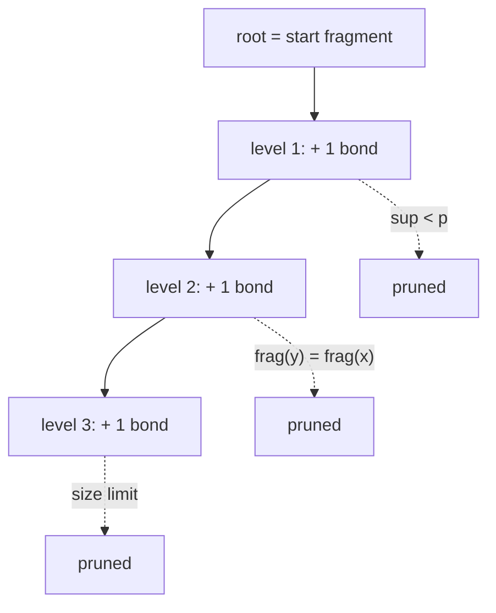

# MoSS Algorithm and Search-Tree Pruning

The concrete search-tree algorithm for [[concepts/frequent-pattern-mining]]: build a tree of
substructures one bond at a time, and cut branches with four pruning rules plus a
canonical-extension scheme that suppresses duplicates.

## Why it matters

> Runtime is **linear in the number of visited search-tree nodes**.

Every node the algorithm never visits is time saved, which makes pruning the entire
engineering content of the method.

## Search-tree construction

```text
ALGORITHM BuildSearchTree(start_fragment, A)
  root  <- start_fragment
  level <- 0
  loop:
      # one bond is added per level
      for each node x at the current level:
          for each embedding e of frag(x):
              extend e by one bond in every possible way
      sort all resulting embeddings
      partition them into equivalence classes   # one class = one substructure
      each class becomes a node of the next level
      level <- level + 1
```

At every point in time a **list of all embeddings** exists. New-level nodes are generated by
extending each embedding; extended embeddings are sorted and grouped into equivalence
classes, and each equivalence class *is* a substructure.


*Each level adds exactly one bond; pruning rules remove subtrees before their embeddings are ever expanded.*

## Pruning rules

### 1. Positive-support-based pruning

Let `y` be an ancestor of node `x` in the search tree, `frag(y)` its substructure and
`sup_A(y)` its positive support. Then:

```text
frag(y) is a subgraph of frag(x)
⇒ sup_A(y) ≥ sup_A(x)
⇒ support values fall monotonically from level to level
⇒ if sup_A(y) < p, the same holds for all successors of y  ⇒ prune the subtree
```

⚠️ The negative support `sup_B(y)` falls in the same way, but the constraint is
`sup_B ≤ n` — a *falling* quantity can always still satisfy it later. **Negative support
must therefore not be used for pruning.**

### 2. Size-based pruning

A maximum pattern size can be prescribed; subtrees below that depth are cut.

### 3. Smallest-fulfilling-pattern pruning

If only the *smallest* patterns satisfying the support constraints are wanted, whole
subtrees below a hit can be cut. ⚠️ **Closedness cannot be used for pruning here** — a
closed fragment is by definition maximal, which is the opposite requirement.

### 4. Structural pruning

Let `y` and `x` be search-tree nodes and let `y` be processed before `x`. The subtree below
`x` can be cut if

```text
frag(y) = frag(x)
```

**Detecting structural identity:** generate a canonical representation of the pattern
(e.g. **USMILES**) and compare it with all already-processed patterns.

| Property | Note |
|---|---|
| **Approximation** | all possible substructures are considered, but duplicates can still occur |
| **Extensions** | symmetric molecules produce children of a node that differ only in the atom ordering |
| **Equivalent-sibling pruning** | removes exactly those symmetric duplicates |
| **Perfect-extension pruning** | if a substructure can be enlarged in the *same way* in **all** its embeddings, no branching is necessary until the maximal common substructure is reached — all hits will contain it |

## Duplicate avoidance by canonical extension

Atoms receive an **ascending number in insertion order** (= atom order number). Then:

```text
1. always extend only at atoms whose order number ≥ the order number of the
   atom added last
2. define an order ≺ on the bonds emanating from an atom; extend only in
   ascending ≺ order:
      a) single ≺ aromatic ≺ double ≺ triple bond
      b) ring-closure bonds (to atoms already in the substructure)
         ≺ open bonds (to new atoms)
      c) order number of the target atom (H ≺ …)
3. forbid ring-closure bonds from atoms with a high order number to atoms
   with a lower order number
```

These three rules make each substructure reachable by exactly one path, which removes
duplicates *by construction* rather than by detection.

## Initial embeddings

Two ways to start the search:

**(a) Start with a common core structure `Z`.** Before the actual search, all embeddings of
`Z` must be found — a substructure search, either with the MoSS algorithm itself (input:
`Z` and one molecule, `p = 100 %`) or with [[concepts/vf2-algorithm]].

**(b) Start without a prescription (no initial mapping).**

```text
root of the search tree : empty structure
level 1                 : all occurring elements, sorted by frequency
following levels        : consider only nodes for atoms whose element was not
                          already considered in the predecessor subtree at level 1
```

## Extensions

| Extension | Mechanism |
|---|---|
| **Contrast patterns** | same algorithm; the negative support is checked for all resulting patterns. Not usable for pruning. The search is accelerated if all mappings for the negative set `B` are also computed and extended continuously. |
| **Ring matching** | molecules with many rings give very high runtimes. Identify all 5-/6-rings and treat each as a **single unit**. |
| **Variable chain length** | analogous to ring matching: carbon chains of variable length can be mapped onto one another. |

## See also

- [[concepts/frequent-pattern-mining]]
- [[concepts/vf2-algorithm]]
- [[concepts/ring-perception]]
- [[exercises/ciw-e4-moss-and-surfaces]]

## Sources

- [[sources/ciw-03-pattern-mining-diagrams-surfaces-and-reduced-graphs]] (pp. 2–5)
